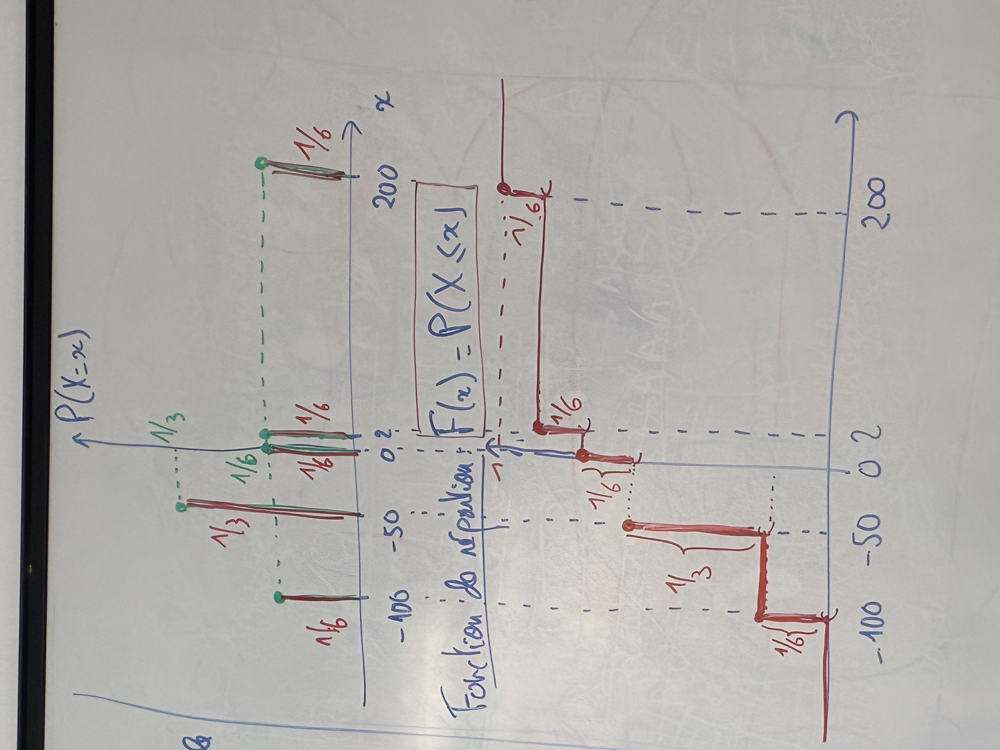
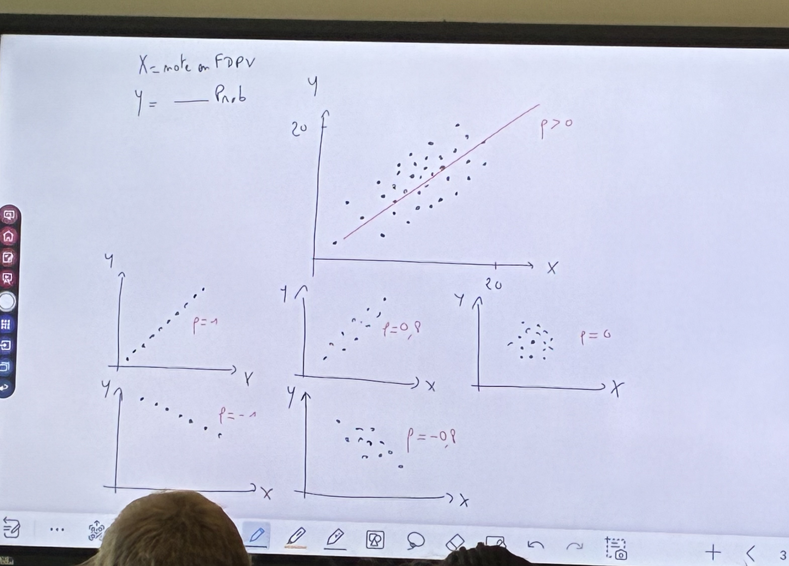
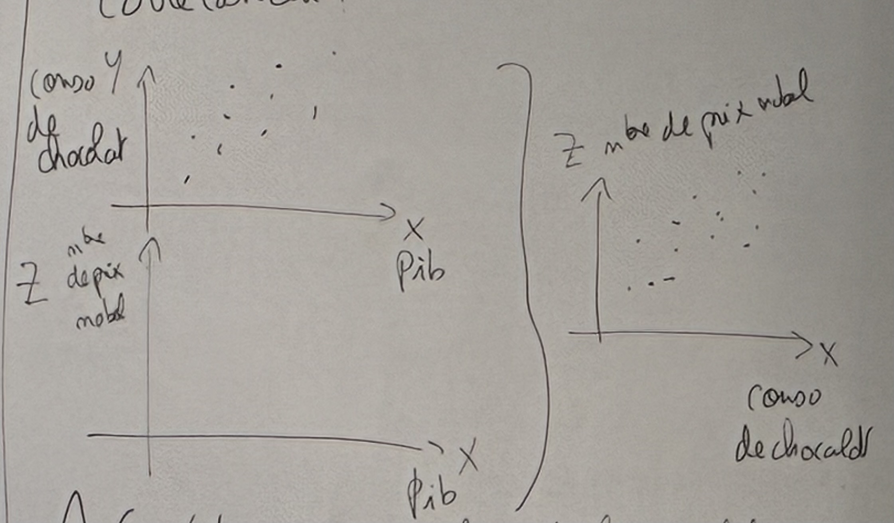
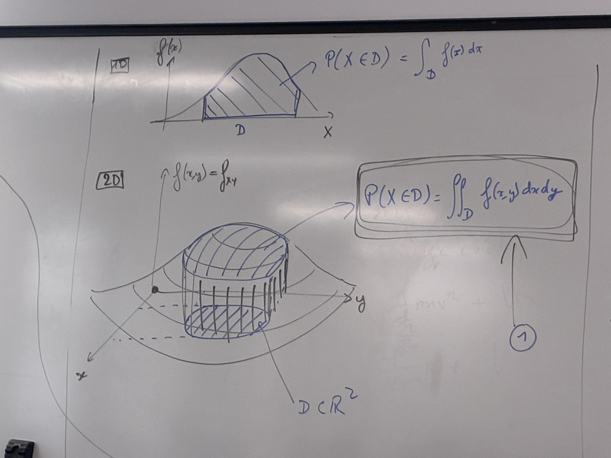

# Chapitre 1 : espaces probabilisés
## 1/ Concepts

- Expérience aléatoire : expérience dont l'issue n'est pas connue et est variable
- Éventualité : type de résultat (aussi appelé événement)
- Univers : ensemble des événements (Ω)

## 2/ Rappel sur les ensembles
```math
A \cap B = \{x\in Ω / x \in A \text{ et } x\in B\} \text{ (Inter)} \\
A \cup B = \{x\in Ω / x \in A \text{ ou } x\in B\} \text{ (Union)} \\
\overline{A} = \{x\in Ω / x\notin A\} \text{ (Complémentaire)}
```

Lois de De Morgan:
```math
\overline{A\cup B} = \overline{A} \cap \overline{B} \\
\overline{A\cap B} = \overline{A} \cup \overline{B}
```
Si $A\cap B = ∅$, alors A et B sont incompatibles.

Un SCE est un système complet d'éléments. Soit un ensemble $A_i\text{  }i\in[1;n]$ une suite de n éléments. Les n éléments forment un SCR si $\forall (j,k) \text{ différents} \in [1;n]^2, A_j\cap A_k = ∅$ et l'union de tous les éléments forment l'univers.

## 3/ Fonction de probabilité
Soit $Ω$ un univers fini ou dénombrable, on désigne par $\mathcal{P}(Ω)$ l'ensemble des parties de $Ω$.

Une fonction de probabilité sur $Ω$ est une fonction $\mathcal{P}(Ω)\rightarrow [0,1] (\mathbb{R})$.

```math
\forall A \subset Ω, \mathcal{P}(A)\in[0,1] \\
\mathcal{P}(Ω) = 1 \\
\mathcal{P}(A) = \frac{\text{card}(A)}{\text{card}(Ω)} \text{ (si Ω est un espace fini)}
```

(Pour plus d'information, voir page 15 du cours)

# Chapitre 2: Probabilités conditionelles
## 1/ Définitions
Soit $(Ω,\mathcal{P})$ un espace probabilisé, A et B deux événements avec B possible.

La probabilité de A sachant B est $\mathcal{P}_B(A)=\mathcal{P}(A|B)=\frac{A\cap B}{P(B)}$

Remarque : quand on fait "sachant B", c'est comme si on changeait de référentiel. Ainsi l'application $A\rightarrow (A|B)$ est une fonction de probabilité.

## 2/ Indépendance
Soit A et B deux événements de $Ω$. A et B sont dit indépendants si $\mathcal{P}(A\cap B) = \mathcal{P}(A)*\mathcal{P}(B)$, ce qui implique $\mathcal{P}(A) = \mathcal{P}(A|B)$.

3 ou plus événements peuvent être considérés comme indépendants entre eux, avec les mêmes propriétés s'appliquant à eux : $\mathcal{P}(A\cap B\cap C) = \mathcal{P}(A) * \mathcal{P}(B) * \mathcal{P}(C)$, 

## 3/ Formule de Bayes
On imagine une maladie M dont la prévalence est de $\mathcal{P}(M) = 5\% = 0.05$. 

On réunit des malades et on leur fait un test (T = test positif). 

$\mathcal{P}(T|M) = 99\%$ (un test sera positif à 99% de chance si une personne malade en prend un).

$\mathcal{P}(\overline{A}|\overline{B}) = 95\%$ (un test sera négatif à 95% de chance si une personne non malade en prend un).

Calculons $\mathcal{P}(M|T)$

```math
\begin{aligned}
\mathcal{P}(M|T) &= \frac{\mathcal{P}(M\cap T)}{\mathcal{P}(T)} \\
 &= \frac{\mathcal{P}(T|M)*\mathcal{P}(M)}{\mathcal{P}(T\cap M)+\mathcal{P}(T\cap \overline{M})} \\
 &= \frac{\mathcal{P}(T|M)*\mathcal{P}(M)}{\mathcal{P}(T|M)*\mathcal{P}(M)+(1-\mathcal{P}(\overline{T}|\overline{M})*\mathcal{P}(\overline{M}))} \\
 &= 0.51 \text{ en utilisant les données de l'énoncé}
\end{aligned}
```
Remarques :
- Probabilités totales : 
```math
\mathcal{P}(T) = \sum^n_{i=1}\mathcal{P}(T|A_i)*P(A_i) \text{ (avec }(A_i)_{i\in [1;n]} \text{ un SCE sur }Ω\text{)}
```
- Bayes : 
```math
\mathcal{P}(M_j|T) = \frac{\mathcal{P}(T|M_j)*\mathcal{P}(M_j)}{\sum^n_{i=1}\mathcal{P}(T|M_i)*\mathcal{P}(M_i)}
```

# Chapitre 3: Variables aléatoires discrètes
$\{-1;7;17\}$ est un ensemble discret car il y a des sauts entre les valeurs

Exemple: $\N$ est un ensemble discret

## 1/ Variable aléatoire

Définition : une variable aléatoire est une fonction $\mathcal{P}$ de $Ω$ sur $\R$, lorsque $(Ω, \mathcal{P})$ est un espace probabilisé.

---
Exemple : un lancer de dés
* Si on tombe sur 1, on perd 100€
* Si on tombe sur 2, on perd 50€
* Si on tombe sur 3, on perd 50€
* Si on tombe sur 4, on gagne 0€
* Si on tombe sur 5, on gagne 2€
* Si on tombe sur 6, on gagne 200€

Soit X une variable aléatoire, et $Ω$ représente l'ensemble des évènements

On apelle support de X (noté $X(Ω)$) l'ensemble des valeurs prises par X. $X(Ω) = \{-100;-50;0;2;200\}$. Si $X(Ω)$ est discret alors la variable aléatoire X est discrète

Note : soit $X$ et $Y$ 2 variables aléatoires et $\lambda$ un réel, $X+Y$ et $\lambda X$ sont des VA.

Théorème : dans un espace probabilisé $(Ω, \mathcal{P})$ et $X$ une VA de support $X(Ω)$ :
```math
\{w\in Ω / X(w) = x\} = (X = x)
```
La famille des $(X=x)$ forme un SCE. (Note: $(X=-50) = \{\text{"On tombe sur 2 ou 3"}\}$)

On peut alors définir notre loi de probabilité, via les valeurs prises de la VA. Soit notre dé équilibré :
* $P(X=-100) = \frac{1}{6}$
* $P(X=-50) = 2*\frac{1}{6} = \frac{1}{3}$
* ...


Ici la fonction est en escalier, donc croissante.

## 2/ Couple de variables aléatoires

Dans un couple de variable aléatoires, un évènement est caractérisé par une valeur $x$ pour la VA $X$, et $y$ pour la VA $Y$.

On regarde la distribution de probabilité $\mathcal{P}(X=x, Y=y)$

---
Exemple : on prend les 40 étudiants de la classe.
* $X$ : la note de CE en FDPV
* $Y$ : la note de CE en probabilités

| -------------- | $4<8$ | $8 \le Y \le 14$ | $Y > 14$ | Total
| -------------- | ----- | ---------------- | -------- | -
| $X<8$          | 5 | 5 | 2 | 12
| $8\le X\le 14$ | 4 | 10 | 5 | 19
| $X > 14 $      | 1 | 5 | 3 | 9
| Total          | 10 | 20 | 10 | **40**

Exemple de calcul :
```math
\begin{align}
\mathcal{P}(X > 14 / Y \ge 8) &= \frac{P(X>14 \cap Y\ge 8)}{P(Y\ge 8)} \\
&= \frac{8}{30}
\end{align}
```

## 3/ L'espérance et la variance
Dans un espace probabilisé $(Ω,\mathcal{P})$ et une VA $X$ discrète avec $X(Ω) = \{x_1, x_2, ... x_n\}$

Définition : l'espérance est ce qu'on peut espérer avoir comme valeur de $X$ en moyenne. Elle est notée $E(X)$.
```math
E(X) = \sum^n_{i=1}(x_i*P(X=x_i))
```
---
Exemple avec notre lancer de dés :
```math
\begin{align}
E(X) &= -100*\frac{1}{6} -50*\frac{1}{3}+0*\frac{1}{6}+2*\frac{1}{6}+200*\frac{1}{6} \\
&= \frac{1}{6}*(-100+(-50*2)+0+2+200) \\
&= \frac{2}{6} \\
&= \frac{1}{3}
\end{align}
```
Donc en moyenne, on gagne $\frac{1}{3}$€ a chaque lancer de dé.

---
Remarque : 
```math
E(\alpha X+\beta Y) = \alpha  E(X) + \beta E(Y) \\
E(g(X)) = \sum^n_{i=1} (g(x_i)*P(X=x_i)) \text{ (théorème du transfert)}
```
---
Exemple :
| $x_i$ | -2 | -1 | 0 | 1 | 2 | 3 | 4
| ----- | -- | -- | - | - | - | - | -
| $P(X=x_i)$ | $\frac{3}{16}$ | $\frac{1}{4}$ | $\frac{1}{8}$ | $\frac{1}{16}$ | $\frac{1}{16}$ | $\frac{1}{8}$ | $\frac{3}{16}$

Soit une VA $Y=X^2$, $Y(Ω) = \{0;1;4;9;16\}$.


| $y_i$ | 0 | 1 | 2 | 3 | 4
| ----- | - | - | - | - | -
| $P(X=x_i)$ | $\frac{1}{8}$ | $\frac{5}{16}$ | $\frac{1}{4}$ | $\frac{1}{8}$ | $\frac{3}{16}$

```math
\begin{align}
E(X) &= -2 *\frac{3}{16} -1 *\frac{1}{4} + ... \\
E(Y) &= 0 *\frac{1}{8} + 1 *\frac{5}{16} + ... \\
\text{Théor. du transfert : } g(X) &= X^2 \\
E(X^2) &= \sum(x_i^2*P(X=x_i)) \\
&= (-2)^2*\frac{3}{16} + (-1)^2*\frac{1}{4} + ... \\
&= \frac{87}{16}
\end{align}
```

Définition : la variance se calcule par $V(X) = E(X^2) - E(X)^2$.

Remarques : 
* Si X est en €, la variance est en €^2 -> l'écart type $\sigma(X) = \sqrt{V(X)}$ est en €.
* $V(aX+b) = a^2V(X)$
* $V(X+Y) = V(X) + V(Y)$ **SI ET SEULEMENT SI** $X \text{ et } Y \text{ indépendants}$

Définition : Soit $X$ une VA d'espérance $m$ et d'écart type $\sigma$, $y=\frac{X-m}{\sigma}$ est une variable centrée et réduite (car l'espérance de $X-m$ vaut 0, et l'écart type vaut maintenant 1).


## 4/ Covariance et coefficients de corrélation

On va travailler maintenant avec deux variables aléatoire X et Y et on va essayer de quantifier le lien entre ces 2 variables aléatoires.

Par exemple, on pourrait dire que X est la VA de la note au CE de probabilité et Y la VA de la note au CE de FDPV. Y a-t-il un lien entre les 2 ? Et comment le caractériser ?

On définit la covariance par :
```math
\operatorname{cov}(x,y) = E(XY) - E(X)E(Y) \\
\text{Remarque : } \operatorname{cov}(X,X) = E(X^2) - E(X)^2 = \operatorname{var}(X)
```
Autre remarque : si les VA X et Y sont indépendantes, alors $\operatorname{cov}(X,Y)=0$.

On définit le coefficient de corrélation $\rho$ comme étant :
```math
\rho(X,Y) = \frac{\operatorname{cov}(X,Y)}{\sigma(X)*\sigma(Y)} \in [-1;1]
```

Ce nombre caractérise à quel point X et Y sont liés. 
- Quand il n'y a pas de corrélation, $\rho(X,Y) = 0$. 
- Au maximum de la corrélation, $\rho(X,Y) =1$ et dans ce cas les points sont alignés et la droite qui passe par ces points est croissante.
- Lorsque $\rho = -1$, il y a anticorrélation parfaite, les points sont alignés et la droite est décroissante.

Exemple de droites :



Est-ce que l'on peut conclure qu'il y a un lien de cause à effet lorsqu'il y a de la corrélation ?



**Attention** : Ce n'est pas parce qu'il y a de la corrélation qu'il y a un lien de cause à effet.

## 5/ Lois usuelles

### A/ Loi uniforme

Soit $X$ une VA discrète, $X$ suit une loi uniforme si toutes les valeurs de $X$ sont équiprobables

```math
\begin{aligned}
&n\in \N^*, X \sim \operatorname{U}([1;n]) \\ 
\text{si } & X(Ω) = [1;n] \\
\text{et } & \forall k \in [1;n], P(X=k) = \frac{1}{n}
\end{aligned}
```
```math
E(X) = \frac{n+1}{2} \\
V(X) = \frac{n^2-1}{12}
```

### B/ Loi de Bernoulli

Soit $X$ une VA discrète sur $X(Ω) = \{0;1\}$ et $P(X=1) = p\in[0;1]$.
```math
X \sim \operatorname{B}(p) \\
E(X) = p \\
V(X) = p(1-p)
```

### C/ Loi binomiale

On fait n épreuves de Bernoulli. X est le nombre de succès parmi les n épreuves. Les épreuves doivent être indépendantes.
```math
X \in [0;n] \\
X\sim \operatorname{Bin}(n,p)
```
```math
E(X) = np \\
V(X) = np(1-p) \\
P(X=k) = \binom{n}{k}*p^k*(1-p)^{n-k} \\
\text{Note : } C^k_n = \binom{n}{k}
```
```math
\text{Rappel : }\binom{n}{k}=\frac{n!}{k!(n-k)!}
```

Remarque : si $X\sim\operatorname{Bin}(n,p)$ et $Y\sim\operatorname{Bin}(m,p)$ alors $X+Y\sim\operatorname{Bin}(n+m,p)$ (si X et Y indépendantes).

### D/ Loi binomiale négative

Pour la binomiale, on joue n fois de manière indépendante à une même épreuve.

Pour la binomiale négative, on joue jusqu'à ce qu'on gagne r fois à cette épreuve

```math
r > 0 \\
X(Ω) = [r;+\infin[ \text{ (On est obligé de jouer r fois)}
```
Probabilité qu'on ait joué j fois pour r fixé (le r-ième succès arrive à la j-ième position) :
```math
\forall j \in [r;+\infin[ \\
P(X=j) = \binom{j-1}{r-1}*p^r*(1-p)^{j-r} \\
```
```math
E(X) = \frac{r}{p} \\
V(X) = \frac{r(1-p)}{p^2}
```

### E/ Loi de Poisson

(Aussi appelée loi des accidents)

Le nombre de personnes arrivant par jour dans un service hospitalier avec une fracture suit une loi de Poisson.
```math
X\sim\operatorname{P}(\lambda) \\
\forall k \in\N \\
P(X=k) = e^{-\lambda}\frac{\lambda^k}{k!}
```
Remarque : 
```math
\begin{aligned}
\sum^n_{k=0}P(X=k)&=\sum^n_{k=0}e^{-\lambda}* \frac{\lambda^k}{k!}\\
&= e^{-\lambda}*\sum^n_{k=0} \frac{\lambda^k}{k!} \\
&= e^{-\lambda}*e^{\lambda} \\
&= 1
\end{aligned}
```
```math
E(X) = \lambda \\
V(X) = \lambda
```

# Chapitre 4: Variables aléatoires continues

## 1/ Introduction

Variable discrète : $\{1;17;22.4;-5\}$

Variable continue : $[1;2.4[$

Une VA $X$ est continue s'il existe $f:\R\rightarrow\R$ tel que :
```math
\begin{cases}
f \ge 0 \\
\forall B \subset \R, P(X\in B) = \int_B f(x)\space dx
\end{cases}
```
$f$ est la densité de probabilité.

(Insérer image illustration 2026-11-02 17:45)

Remarque :
- $P(X=a)$ peut être non nul dans le discret
- $P(X=a) = 0$ toujours dans le continu (personne ne fait 1m70 pile, toujours 1.70072384798 ou quelque chose de similaire)

Définition : on appelle **fonction de répartition** pour la VA $X$ : $F(x) = P(X\le x)$

---
Exemple : Soit $X$ uniforme en $k$ sur $[-2;3]$.
```math
\begin{aligned}
&\int_\R f(x)\space dx = 1 \\
\Rightarrow &\int^3_{-2}k\space dx = 1 \\
\Rightarrow &\left[kx\right]^3_{-2} = 3k-(-2k) = 5k = 1 \\
\Rightarrow &k=\frac{1}{5}
\end{aligned}
```
```math
F(x) = P(X\le x) \\
\text{si } x\le -2, \space F(x) = 0 \\
\text{si } x\ge 3, \space F(x) = 0 \\
\begin{aligned}
\text{si } x\in [-2;3], \space F(x) &= P(X\le x) \\
&= \int^{t=x}_{-\infin}f(t)\space dt \\
&= \int^{t=x}_{-2}f(t)\space dt \\
&= \int^{t=x}_{-2}\frac{1}{5}\space dt \\
&= \left[\frac{1}{5}\right]^{t=x}_{t=-2} \\
&= \frac{1}{5}x-\frac{1}{5}(-2) \\
&= \frac{1}{5}x+\frac{2}{5}
\end{aligned}
```

Remarque : 
```math
\begin{aligned}
P(-1\le X\le 2) &= \int^{t=2}_{t=-1}f(t)\space dt \\
&= \int^{t=2}_{t=-1}\frac{1}{5}\space dt \\
&= \frac{3}{5}
\end{aligned}
\\
\begin{aligned}
P(-1\le X \le 2) &= P(\le 2) - P(X\le -1)  \\
&= F(2) - F(-1) \\
P(-1 \le X \le 2) &= 1-P(-1 \le X) - P(2\ge X)
\end{aligned}
```

## 2/ Couples de VA continues

**Définition** : deux VA $X$ et $Y$ sont conjointement continues s'il existe $f_{X,Y}:\R^2\rightarrow\R$ telle que 
- $f_{X,Y}\ge 0$ 
- $\forall C \subset\R^2, P((X,Y)\in C) = \int\int f_{X,Y}(X,Y)\space dxdy$



**Proposition** : si on connait $f_{X,Y}$ alors on connait $f_X$ et $f_Y$

```math
f_X(x) = \int^{y=+\infin}_{y=-\infin}f_{X,Y}(x,y)\space dy \\
f_Y(y) = \int^{x=+\infin}_{x=-\infin}f_{X,Y}(x,y)\space dx
```

**Définition** : soit $X$ et $Y$ conjointement continues

$X$ et $Y$ indépendantes : 
- si $f_{X,Y}(x,y) = f_X(x)f_Y(y)$
- ou si $F_{X,Y}(x,y) = F_X(x)F_Y(y)$

(f est la fonction de densité de probabilité, F est la fonction de répartition)

**Définition** : $F_{X,Y}(x,y) = P(X\le x, Y\le y)$

