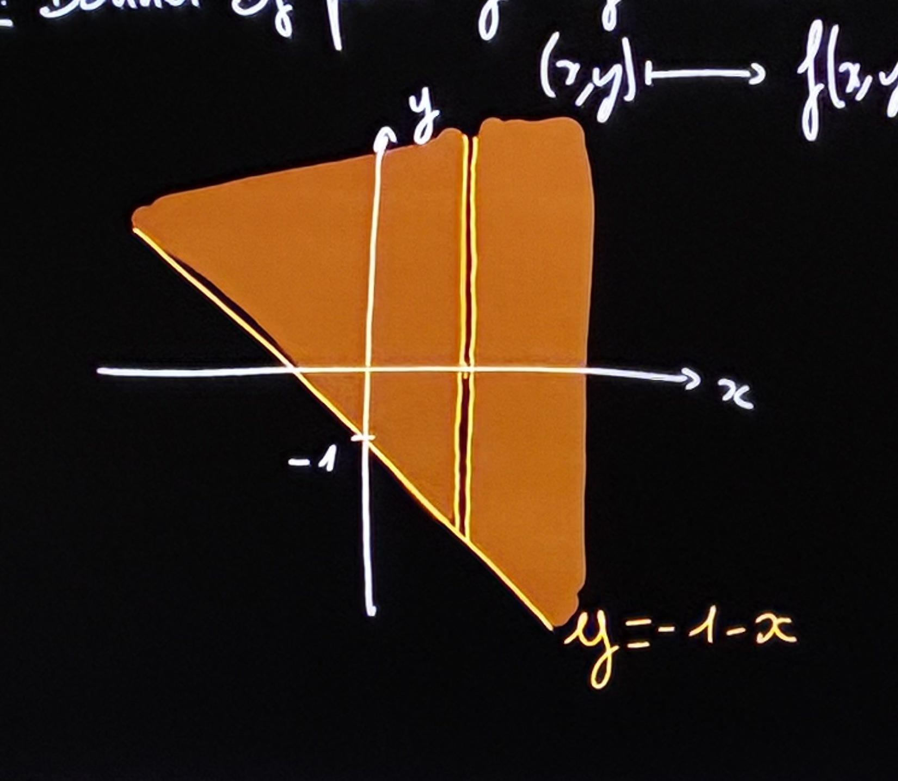
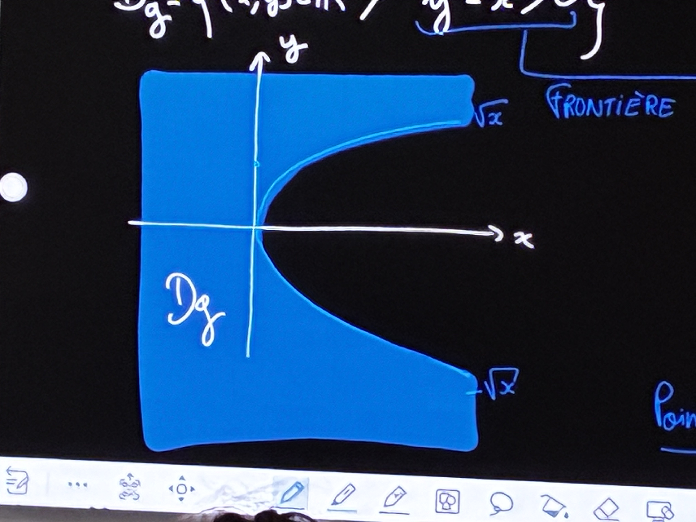
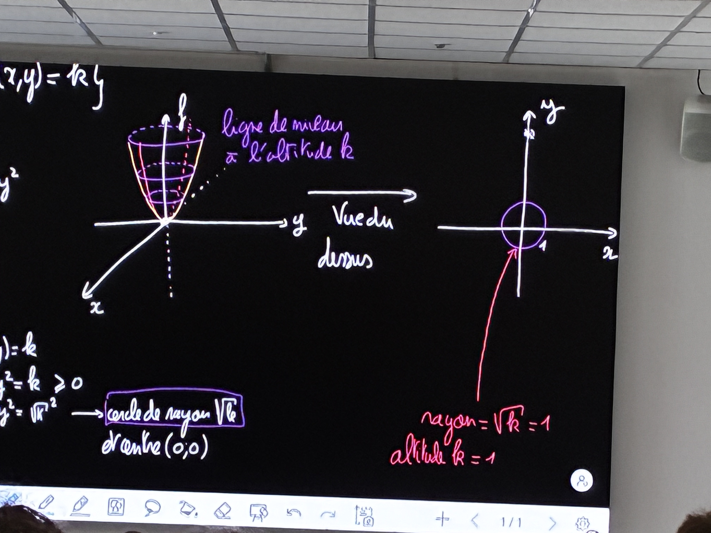

# Chapitre 1: Fonctions de plusieurs variables

Jusqu’à présent, vous avez principalement travaillé avec des fonctions d’une seule variable. L'idée de ce cours est de travailler sur des fonctions à n variables (dont l'image est dans $\mathbb{R}$). On va regarder les caractéristiques: continuité, dérivabilité, etc.

Exemple en physique: PV = mRT: plusieurs variables
```math
P=\frac{mRT}{V}=f(m,T,V)
```

Exemple en entreprise: le chiffre d'affaire peut être une fonction qui dépend de plusieurs variables.

## 1/ Définitions

Définition: Une fonction à 2 variables est une correspondance entre des valeurs $(x,y)\in D_f \subset\mathbb{R}^2$, avec $f:(x,y)\rightarrow f(x,y)\in\mathbb{R}$ 

Les fonction à 2 variables sont représentées dans des axes en 3D, avec l'axe X venant vers nous, l'axe Y face à nous, et la fonction vers le haut. L'application de la fonction représente donc une nappe


Définition: la fonctions à n variables est une correspondance entre $(x_1,x_2, ..., x_n)\in D_f \subset\mathbb{R}^n$, avec $f:(x,y)\rightarrow f(x,y)\in\mathbb{R}$ 

## 2/ L'ensemble de définition $D_f$

**Rappel**:
```math
\sqrt{x} \rightarrow x \ge 0 \\
\ln{x} \rightarrow x > 0 \\
\frac{1}{x} \rightarrow x \neq 0
```

---

Exemple: donner $D_f$ pour $f: D_f \rightarrow \mathbb{R}$
```math
(x,y) \rightarrow f(x,y)=\frac{\sqrt{x+y+1}}{x-1}
```
On a $x \neq 1$ et $x+y+1 \ge 0$. Les couples valeurs valides de x et y sont donc:


```math
D_f = \Big\{(x,y)\in\mathbb{R} / x\neq1 \text{ et } x+y+1\ge0\Big\}
```

---

Autre exemple: 
```math
g: D_g\rightarrow\mathbb{R} \\
(x,y) \rightarrow g(x,y) = x\ln(y^2-x) \\
D_g = \Big\{(x,y)\in\mathbb{R}^2 / y^2-x>0\Big\}
```
Or:
```math
y^2-x=0 \Leftrightarrow y=\pm\sqrt{x}
```
On se retrouve donc avec les couples valides suivants (points sur la parabole non inclus):


---

## 3/ Représentation à 3D des fonctions de 2 variables
**Définition**: On appelle graphe la partie de $\mathbb{R}^3$ égale à:
```math
\bigg\{\Big((x,y), f(x,y)\Big)\in\mathbb{R}^3/(x,y)\in D_f\bigg\}
```
Comme mentionné précédemment, le graphe devrait ressembler à une nappe.

---

Exemple: $f:(x,y)\rightarrow 4-x-2y$


---

## 4/ Les lignes de niveau

Définition: Pour une altitude k, la ligne de niveau associée est:
```math
\Big\{(x,y)\in D_f/f(x,y)=k\Big\}
```
Exemple: 
```math
f:D_f\rightarrow\mathbb{R} \\
(x,y)\rightarrow x^2+y^2
```
On remarque que:
```math
f(x,0) = x^2\\
f(0,y) = y^2
```


---

Exemple : $f(x,y)\rightarrow\frac{-3y}{x^2+y^2+1}$

Traçons les lignes niveau d'altitude k
- Si $y=0$, $k=0$
- Sinon: $-\frac{3y}{k}=x^2+y^2+1$

**Rappel**: L'équation du cercle de centre $(x_0, y_0)$ et de rayon $R$ est:
```math
(x-x_0)^2+(y-y_0)^2=R^2
```
On peut donc transformer notre formule en:
```math
x^2+\left(y+\frac{3}{2k}\right)^2=\left(\frac{3}{2k}\right)^2-1 \\
\Rightarrow\text{équation de cercle de rayon }\sqrt{\left(\frac{3}{2k}\right)^2-1}\\
\text{et de centre }\left(0,-\frac{3}{2k}\right)
```

**Remarque**: $\left(\frac{3}{2k}\right)^2-1\ge0$ donne les altitudes k où f existe.

---
# Chapitre 2: Limites et continuité

Nous connaissons déjà la notion de limite à 1 variable. Dans ce cas, il n'y a qu'une direction pour aller en $+\infin$. Avec deux variables, faire tendre une seule des variables vers $+\infin$ donne une infinité de possibilités, selon la valeur de l'autre variable.


De la même manière, quand on fait tendre vers un point d'une fonction à une variable, il n'y a qu'une direction (et donc 2 sens). Lorsque qu'on ajoute une seconde variable, il y a donc une infinité de direction pour arriver à ce point.


## 1/ La limite

À une variable:
- On dit que f a une limite $l$ en x=a si f(x) devient aussi proche que l'on veut de $l$ quand x est suffisamment proche de a
- On écrit $\lim_{x\rightarrow a} f(x) = l$
- Remarque: $\forall \epsilon > 0, \exists \beta > 0, \forall x \in [a-\beta, a+\beta], |f(x)-l| < \epsilon$

À deux variables:
- On dit que f a une limite $l$ en **(x,y)=(a,b)** si **f(x,y)** devient aussi proche que l'on veut de $l$ quand (x,y) est suffisamment proche de (a,b).
- On écrit $\lim_{(x,y)\rightarrow(a,b)}f(x,y) = l$

-> Peu importe le chemin qui mène vers (a,b), la limite sera toujours $l$ si la limite existe.

-> Pouvons-nous casser cette définition ?

**Méthode 1** : Pour montrer qu'une limite n'existe pas, il suffit de trouver 2 chemins dont la limite est différente.

---

Exemple :
```math
f: D_f \rightarrow \mathbb{R} \\
(x,y) \rightarrow \frac{x^2-y^2}{x^2+y^2}
```

1) Trouver $D_f$: $\Big\{ (x,y)\in\mathbb{R}^2 / x^2+y^2 \neq 0\Big\} = \mathbb{R}^2-\Big\{(0,0)\Big\}$
2) Quelle est la limite de f en (2,1) ? $f(2,1) = \frac{2^2-1^2}{2^2+1^2} = \frac{3}{5}$
3) Quelle est la limite de f en (0,0) ?

Plusieurs chemins:
```math
f(x,0) = \frac{x^2}{x^2} = 1 \\
f(0,y) = \frac{-y^2}{y^2} = -1
```
=> On a trouvé deux chemins avec des valeurs différentes de limite donc f n'a pas de limite en (0,0)

---

Autre exemple :
```math
f: D_f \rightarrow \mathbb{R} \\
(x,y) \rightarrow \frac{xy}{x^2+y^2}
```

f a-t-elle une limite en (0,0) ?

On cherche d'abord à montrer que f n'a pas de limite en (0,0) en cherchant des chemins :
```math
f(x,0) = \frac{x*0}{x^2+0^2} = 0 \\
f(0,y) = \frac{0*y}{0^2+y^2} = 0 \\
f(x,x) = \frac{xx}{x^2+x^2} = \frac{x^2}{2x^2} = \frac{1}{2}
```

On a trouvé deux chemins dont les limites en (0,0) sont différentes donc f n'a pas de limite en (0,0)

---

Autre exemple :
```math
f: D_f \rightarrow \mathbb{R} \\
(x,y) \rightarrow \frac{xy^2}{x^2+y^4} \\
D_f = \Big\{(x,y)\in\mathbb{R}^2 / x^2+y^4 \neq 0\Big\} = \mathbb{R}^2 - \Big\{(0,0)\Big\}
```

Essayons de calculer plusieurs limites :

```math
f(x,0) = \frac{x*0}{x^2+0^4} = 0 \\
f(0,y) = \frac{0*y^2}{0^2+y^4} = 0 \\
f(x,x) = \frac{x^3}{x^2+x^4} = \frac{x^3}{x^2(1+x^2)} = \frac{x}{1+x^2} \underset{x\rightarrow 0}{\rightarrow} 0\\
f(x^2, x) = \frac{x^4}{x^4+x^4} = \frac{1}{2}
```

On a trouvé deux chemins dont les limites en (0,0) sont différentes donc f n'a pas de limite en (0,0)

---

Autre exemple :
```math
f: D_f \rightarrow \mathbb{R} \\
(x,y) \rightarrow \frac{3x^2y}{x^2+y^2}
```

Essayons de calculer plusieurs limites :

```math
f(x,0) = 0 \\
f(0,y) = 0 \\
f(x,x) = \frac{3x}{2} \underset{x\rightarrow 0}{\rightarrow} 0 \\
```
```math
f(x,x) = \frac{-3x}{2} \underset{x\rightarrow 0}{\rightarrow} 0 \\
```
```math
f(x,x^2) = \frac{3x^2}{1+x^2} \underset{x\rightarrow 0}{\rightarrow} 0 \\
```

**Méthode 2** : Pour montrer que f(x,y) a une limite qui vaut $l$ en (x,y) = (a,b), on majore $|f(x-y)-l|$ par une fonction qui tend vers 0 quand $(x,y)\rightarrow(a,b)$
```math
\begin{align}
0&\le|f(x,y)-0| \\
&\le\Big|\frac{3x^2y}{x^2+y^2}-0\Big| \\
&\le\Big|\frac{3x^2y}{x^2+y^2}\Big| \\
&\le\frac{|3x^2y|}{|x^2+y^2|} \\
&\le\frac{3x^2|y|}{x^2+y^2}
\end{align}
```
Rappel: $x^2\le x^2+y^2$ donc $\frac{1}{x^2}\ge\frac{1}{x^2+y^2}$
```math
\begin{align}
\frac{3x^2|y|}{x^2+y^2}&\le\frac{3x^2|y|}{x^2} \\
&\le 3|y|
\end{align}
```

$\lim_{(x,y)\rightarrow(0,0)} 3|y| = 0$ donc par les encadrées, $lim_{(x,y)\rightarrow(0,0)} f$ existe et vaut 0.

