# Chapitre 1: Fonctions de plusieurs variables

Jusqu’à présent, vous avez principalement travaillé avec des fonctions d’une seule variable. L'idée de ce cours est de travailler sur des fonctions à n variables (dont l'image est dans $\mathbb{R}$). On va regarder les caractéristiques: continuité, dérivabilité, etc.

Exemple en physique: PV = mRT: plusieurs variables
```math
P=\frac{mRT}{V}=f(m,T,V)
```

Exemple en entreprise: le chiffre d'affaire peut être une fonction qui dépend de plusieurs variables.

## 1/ Définitions

Définition: Une fonction à 2 variables est une correspondance entre des valeurs $(x,y)\in D_f \subset\mathbb{R}^2$, avec $f:(x,y)\rightarrow f(x,y)\in\mathbb{R}$ 

Les fonction à 2 variables sont représentées dans des axes en 3D, avec l'axe X venant vers nous, l'axe Y face à nous, et la fonction vers le haut. L'application de la fonction représente donc une nappe

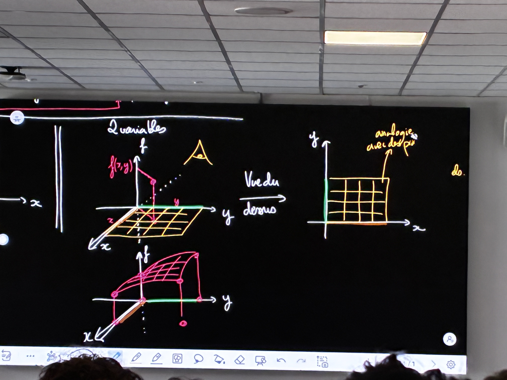

Définition: la fonctions à n variables est une correspondance entre $(x_1,x_2, ..., x_n)\in D_f \subset\mathbb{R}^n$, avec $f:(x,y)\rightarrow f(x,y)\in\mathbb{R}$ 

## 2/ L'ensemble de définition $D_f$

**Rappel**:
```math
\sqrt{x} \rightarrow x \ge 0 \\
\ln{x} \rightarrow x > 0 \\
\frac{1}{x} \rightarrow x \neq 0
```

---

Exemple: donner $D_f$ pour $f: D_f \rightarrow \mathbb{R}$
```math
(x,y) \rightarrow f(x,y)=\frac{\sqrt{x+y+1}}{x-1}
```
On a $x \neq 1$ et $x+y+1 \ge 0$. Les couples valeurs valides de x et y sont donc:


```math
D_f = \Big\{(x,y)\in\mathbb{R} / x\neq1 \text{ et } x+y+1\ge0\Big\}
```

---

Autre exemple: 
```math
g: D_g\rightarrow\mathbb{R} \\
(x,y) \rightarrow g(x,y) = x\ln(y^2-x) \\
D_g = \Big\{(x,y)\in\mathbb{R}^2 / y^2-x>0\Big\}
```
Or:
```math
y^2-x=0 \Leftrightarrow y=\pm\sqrt{x}
```
On se retrouve donc avec les couples valides suivants (points sur la parabole non inclus):


---

## 3/ Représentation à 3D des fonctions de 2 variables
**Définition**: On appelle graphe la partie de $\mathbb{R}^3$ égale à:
```math
\bigg\{\Big((x,y), f(x,y)\Big)\in\mathbb{R}^3/(x,y)\in D_f\bigg\}
```
Comme mentionné précédemment, le graphe devrait ressembler à une nappe.

---

Exemple: $f:(x,y)\rightarrow 4-x-2y$

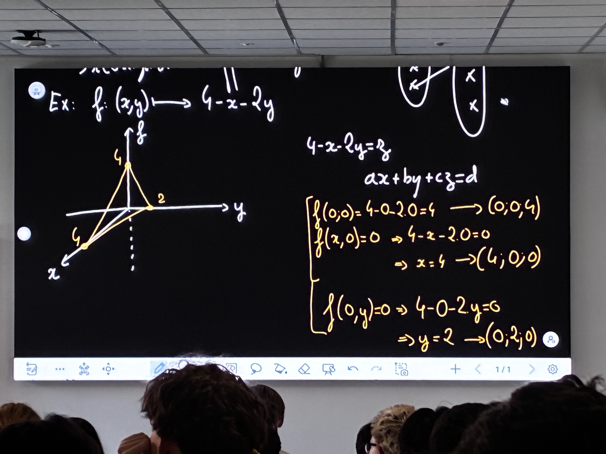

---

## 4/ Les lignes de niveau

Définition: Pour une altitude k, la ligne de niveau associée est:
```math
\Big\{(x,y)\in D_f/f(x,y)=k\Big\}
```
Exemple: 
```math
f:D_f\rightarrow\mathbb{R} \\
(x,y)\rightarrow x^2+y^2
```
On remarque que:
```math
f(x,0) = x^2\\
f(0,y) = y^2
```


---

Exemple : $f(x,y)\rightarrow\frac{-3y}{x^2+y^2+1}$

Traçons les lignes niveau d'altitude k
- Si $y=0$, $k=0$
- Sinon: $-\frac{3y}{k}=x^2+y^2+1$

**Rappel**: L'équation du cercle de centre $(x_0, y_0)$ et de rayon $R$ est:
```math
(x-x_0)^2+(y-y_0)^2=R^2
```
On peut donc transformer notre formule en:
```math
x^2+\left(y+\frac{3}{2k}\right)^2=\left(\frac{3}{2k}\right)^2-1 \\
\Rightarrow\text{équation de cercle de rayon }\sqrt{\left(\frac{3}{2k}\right)^2-1}\\
\text{et de centre }\left(0,-\frac{3}{2k}\right)
```

**Remarque**: $\left(\frac{3}{2k}\right)^2-1\ge0$ donne les altitudes k où f existe.

---
# Chapitre 2: Limites et continuité

Nous connaissons déjà la notion de limite à 1 variable. Dans ce cas, il n'y a qu'une direction pour aller en $+\infty$. Avec deux variables, faire tendre une seule des variables vers $+\infty$ donne une infinité de possibilités, selon la valeur de l'autre variable.

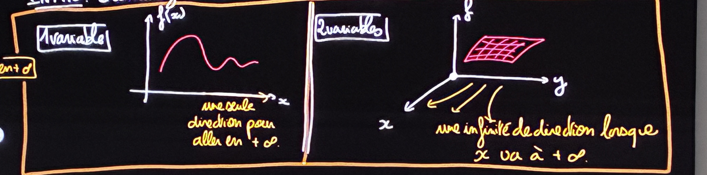

De la même manière, quand on fait tendre vers un point d'une fonction à une variable, il n'y a qu'une direction (et donc 2 sens). Lorsque qu'on ajoute une seconde variable, il y a donc une infinité de directions pour arriver à ce point.

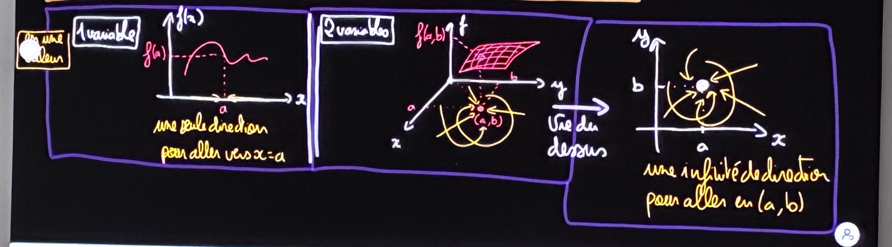

## 1/ La limite

À une variable:
- On dit que f a une limite $l$ en x=a si f(x) devient aussi proche que l'on veut de $l$ quand x est suffisamment proche de a
- On écrit $\lim_{x\rightarrow a} f(x) = l$
- Remarque: $\forall \epsilon > 0, \exists \beta > 0, \forall x \in [a-\beta, a+\beta], |f(x)-l| < \epsilon$

À deux variables:
- On dit que f a une limite $l$ en **(x,y)=(a,b)** si **f(x,y)** devient aussi proche que l'on veut de $l$ quand (x,y) est suffisamment proche de (a,b).
- On écrit $\lim_{(x,y)\rightarrow(a,b)}f(x,y) = l$

-> Peu importe le chemin qui mène vers (a,b), la limite sera toujours $l$ si la limite existe.

-> Pouvons-nous casser cette définition ?

**Méthode 1** : Pour montrer qu'une limite n'existe pas, il suffit de trouver 2 chemins dont la limite est différente.

---

Exemple :
```math
f: D_f \rightarrow \mathbb{R} \\
(x,y) \rightarrow \frac{x^2-y^2}{x^2+y^2}
```

1) Trouver $D_f$: $\Big\{ (x,y)\in\mathbb{R}^2 / x^2+y^2 \neq 0\Big\} = \mathbb{R}^2-\Big\{ (0,0)\Big\}$
2) Quelle est la limite de f en (2,1) ? $f(2,1) = \frac{2^2-1^2}{2^2+1^2} = \frac{3}{5}$
3) Quelle est la limite de f en (0,0) ?

Plusieurs chemins:
```math
f(x,0) = \frac{x^2}{x^2} = 1 \\
f(0,y) = \frac{-y^2}{y^2} = -1
```
=> On a trouvé deux chemins avec des valeurs différentes de limite donc f n'a pas de limite en (0,0)

---

Autre exemple :
```math
f: D_f \rightarrow \mathbb{R} \\
(x,y) \rightarrow \frac{xy}{x^2+y^2}
```

f a-t-elle une limite en (0,0) ?

On cherche d'abord à montrer que f n'a pas de limite en (0,0) en cherchant des chemins :
```math
f(x,0) = \frac{x*0}{x^2+0^2} = 0 \\
f(0,y) = \frac{0*y}{0^2+y^2} = 0 \\
f(x,x) = \frac{xx}{x^2+x^2} = \frac{x^2}{2x^2} = \frac{1}{2}
```

On a trouvé deux chemins dont les limites en (0,0) sont différentes donc f n'a pas de limite en (0,0)

---

Autre exemple :
```math
f: D_f \rightarrow \mathbb{R} \\
(x,y) \rightarrow \frac{xy^2}{x^2+y^4} \\
D_f = \Big\{(x,y)\in\mathbb{R}^2 / x^2+y^4 \neq 0\Big\} = \mathbb{R}^2 - \Big\{(0,0)\Big\}
```

Essayons de calculer plusieurs limites :

```math
f(x,0) = \frac{x*0}{x^2+0^4} = 0 \\
f(0,y) = \frac{0*y^2}{0^2+y^4} = 0 \\
f(x,x) = \frac{x^3}{x^2+x^4} = \frac{x^3}{x^2(1+x^2)} = \frac{x}{1+x^2} \underset{x\rightarrow 0}{\rightarrow} 0\\
f(x^2, x) = \frac{x^4}{x^4+x^4} = \frac{1}{2}
```

On a trouvé deux chemins dont les limites en (0,0) sont différentes donc f n'a pas de limite en (0,0)

---

Autre exemple :
```math
f: D_f \rightarrow \mathbb{R} \\
(x,y) \rightarrow \frac{3x^2y}{x^2+y^2}
```

Essayons de calculer plusieurs limites :

```math
f(x,0) = 0 \\
f(0,y) = 0 \\
f(x,x) = \frac{3x}{2} \underset{x\rightarrow 0}{\rightarrow} 0 \\
```
```math
f(x,x) = \frac{-3x}{2} \underset{x\rightarrow 0}{\rightarrow} 0 \\
```
```math
f(x,x^2) = \frac{3x^2}{1+x^2} \underset{x\rightarrow 0}{\rightarrow} 0 \\
```

**Méthode 2** : Pour montrer que f(x,y) a une limite qui vaut $l$ en (x,y) = (a,b), on majore $|f(x,y)-l|$ par une fonction qui tend vers 0 quand $(x,y)\rightarrow(a,b)$
```math
\begin{align}
0&\le|f(x,y)-0| \\
&\le\Big|\frac{3x^2y}{x^2+y^2}-0\Big| \\
&\le\Big|\frac{3x^2y}{x^2+y^2}\Big| \\
&\le\frac{|3x^2y|}{|x^2+y^2|} \\
&\le\frac{3x^2|y|}{x^2+y^2}
\end{align}
```
Rappel: $x^2\le x^2+y^2$ donc $\frac{1}{x^2}\ge\frac{1}{x^2+y^2}$
```math
\begin{align}
\frac{3x^2|y|}{x^2+y^2}&\le\frac{3x^2|y|}{x^2} \\
&\le 3|y|
\end{align}
```

$\underset{(x,y)\rightarrow(0,0)}\lim 3|y| = 0$ donc par les encadrées, $\underset{(x,y)\rightarrow(0,0)}\lim f$ existe et vaut 0.


# Chapitre 3: Dérivées partielles

## 1/ Intégrale double sur un domaine rectangulaire :

```math
\int^{x=b}_{x=a}(\int^{y=d}_{y=c}f(x,y)\space dy)\space dx
```
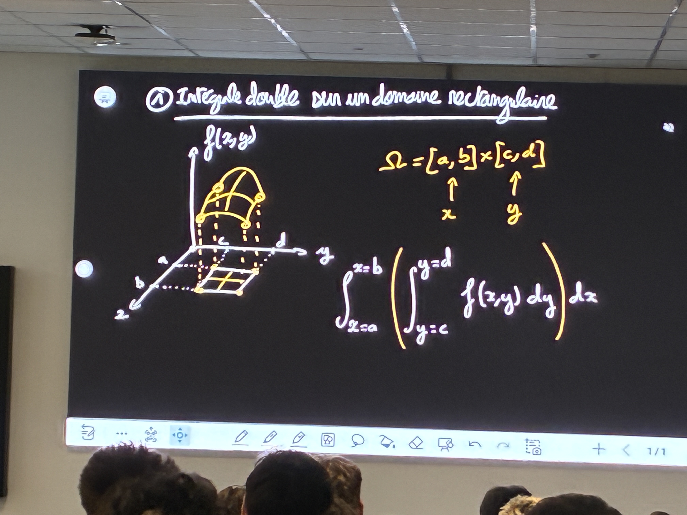

(L'ordre de l'intégrale n'importe pas, on peut faire x ou y en premier)
--- 
Exemple :
```math
\begin{aligned}
I&=\int^{x=3}_{x=0}(\int^{y=2}_{y=1}x^2y\space dy)\space dx \\
&=\int^{x=3}_{x=0}\Bigg[x^2\frac{y^2}{2}\Bigg]^{y=2}_{y=1}\space dx \\
&=\int^{x=3}_{x=0}\Bigg(x^2\frac{2^2}{2}-x^2\frac{1^2}{2}\Bigg)\space dx \\
&=\int^{x=3}_{x=0}\Bigg(\frac{3}{2}x^2\Bigg)\space dx \\
&=\Bigg[\frac{3}{2}*\frac{x^3}{3}\Bigg]^3_0 \\
&=\frac{27}{2}
\end{aligned}
```
Visualisation de faire l'intégrale de x ou y en premier :
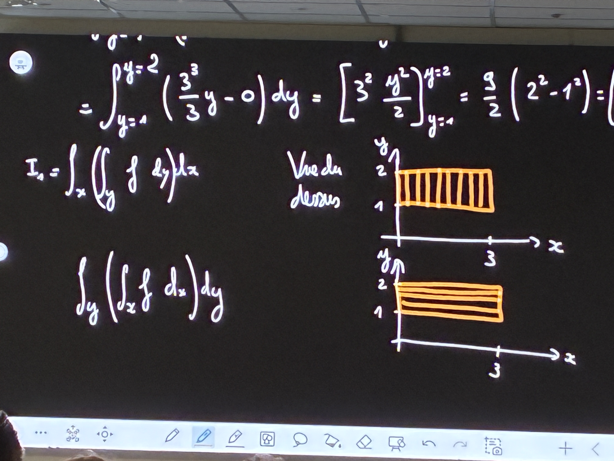

## 1.5/ Théorème de Fabini
```math
\begin{aligned}
&\int^{x=b}_{x=a}\int^{y=d}_{y=c}f(x,y)\space dy \space dx \\
=& \int^{y=d}_{y=c}\int^{x=b}_{x=a}f(x,y)\space dx \space dy \\
\end{aligned}
```
(à appliquer dès que f est $C^0$ (donc une ligne continue) sur [a,b]x[c,d])

Remarques :
* Si f = 1
```math
\int^{x=b}_{x=a}\int^{y=d}_{y=c}f(x,y)\space dy \space dx = (b-a)*(d-c) = \text{aire rectangle}
```
* Si $f(x,y) = g(x)*h(y)$
```math
\begin{aligned}
&\int^{x=b}_{x=a}\int^{y=d}_{y=c}f(x,y)\space dy \space dx \\
=&\Bigg(\int^{x=b}_{x=a}g(x)\space dx\Bigg)*\Bigg(\int^{y=d}_{y=c}h(y)\space dy\Bigg)
\end{aligned}
```

## 2/ Intégrales doubles sur des domaines bornés

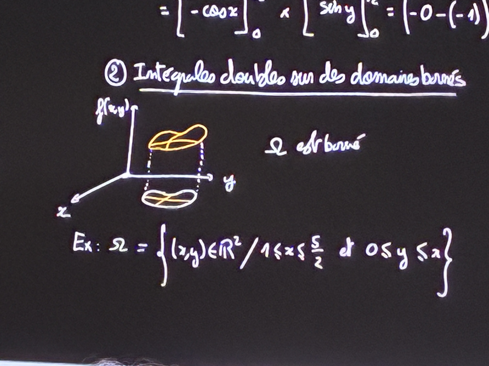
Note sur l'image :
```math
\Omega=\Big\{(x,y)\in\R^2/1\le x\le\frac{5}{2} \text{ et } 0\le y \le x\Big\}
```
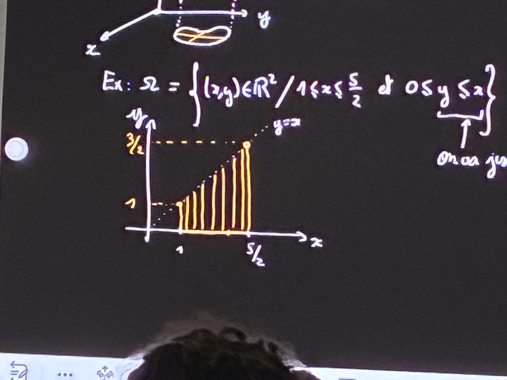

On note que dans ce cas là, le calcul de l'intégrale est :
```math
I = \int^{x=\frac{5}{2}}_{x=1}\int^{y=x}_{y=0}f(x,y)\space dy \space dx
```
et l'intégrale n'est donc plus inversible facilement, car la seconde intégrale dépend de la première. Dans ce cas ci, l'intégrale est égale à
```math
\begin{aligned}
I &= \int^{y=1}_{y=0}\int^{x=\frac{5}{2}}_{x=1}f(x,y)\space dx \space dy\\
&+ \int^{y=\frac{5}{2}}_{y=1}\int^{x=\frac{5}{2}}_{x=y}f(x,y)\space dx \space dy
\end{aligned}
```
Démonstration des 2 intégrales (première en jaune, deuxième en bleu) :
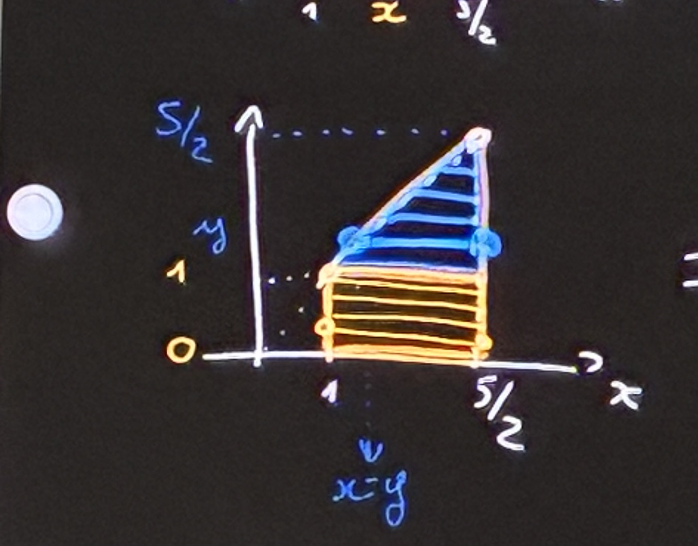
À noter que 2 intégrales peuvent être plus faciles à calculer qu'une intégrale compliquée.

## 3/ Changements de variables
Soit $f(x,y) = g(r,\theta)$
```math
\begin{aligned}
\text{Coordonnées cartésiennes }&= \int_x\int_yf(x,y)\space dy\space dx \\
\text{Coordonnées polaires }&= \int_r\int_\theta g(r,\theta)\space dr\space d\theta
\end{aligned}
```
(Jacobin du polaire)

--- 
Exemple :
```math
D = \Big\{(x,y)\in\R^2/y\ge0\text{ et }1\le x^2+y^2\le 4\Big\}
```
```math
\begin{aligned}
&\int\int_D(3x+y^2)\space dx\space dy \\
=&\int^{r=2}_{r=1}\int^{\theta=π}_{\theta=0}(3r\cos{\theta}+r^2\sin^2\theta)r\space dr\space d\theta
\end{aligned}
```
---
Autre exemple :
```math
f(x,y) =1 \\
R \in \R \\
D=\Big\{(x,y)\in\R^2/x^2+y^2\le R^2\Big\}
```
Aire du disque :
```math
\begin{aligned}
\int\int_Df(x,y)\space dx\space dy &=\int^{r=R}_{r=0}\int^{\theta=2π}_{\theta=0}f*r\space dr\space d\theta \\
&= \int^{r=R}_{r=0}\int^{\theta=2π}_{\theta=0}r\space dr\space d\theta \\
&= \int^{r=R}_{r=0}r\space dr *\int^{\theta=2π}_{\theta=0}d\theta\\
&= \Big[\frac{1^2}{2}\Big]^R_0*\Big[1\Big]^{2π}_0 \\
&= πR^2
\end{aligned}
```

## 4/ Intégrales triples

```math
I=\int_x\int_y\int_zf(x,y,z)\space dz\space dy\space dx
```
Changement de variables sphérique (avec $(r,\theta,\phi)$)

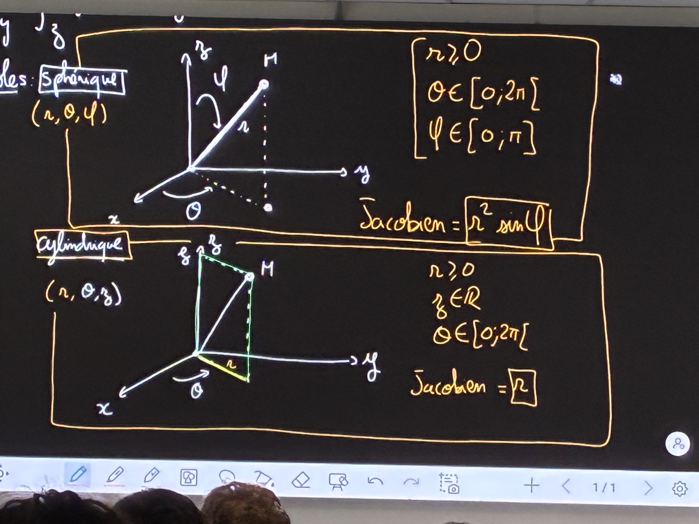


# Chapitre 4: Intégrales multiples

# Chapitre 5: Convexité

# Chapitre 6: Extrema

## 1/ Définitions

On connait déjà la notion de minimum et maximum local/global.

On définit un minimum ou maximum local comme étant le point le plus bas/haut dans les points contenus dans une boule de rayon $r$.

Le minimum/maximum global se définit par rapport au domain de définition $D_f$ de la fonction.

Théorème : les extrema ne peuvent se produire qu'à des points spécifiques :
- Points critiques : Les points où $\frac{\partial f}{\partial x} = 0 \space\forall i$ (dérivée nulle)
- Point singulier : dérivée n'existe pas (rare)
- Point frontière : (il faut une frontière)

Très souvent, on cherchera seulement les points critiques car les fonctions sont sur $C^\infin$ et sans frontière.

Pour trouver les points critiques on va résoudre un système d'équations.

--- 
Exemple :
```math
f:\R^2 \rightarrow\R \\
(x,y) \rightarrow 2x^3-6xy+3y^2
````
On est sur $\R^2$ donc pas de frontière. f est un polynome donc est $C^\infin$ donc pas de points singuliers. Cherchons donc les points critiques :
```math
\begin{cases}
\frac{\partial f}{\partial x} = 0 \\
\frac{\partial f}{\partial y} = 0
\end{cases}
\Leftrightarrow \vec{\nabla} f = \vec{0} \Leftrightarrow 
\begin{pmatrix}
\frac{\partial}{\partial x} \\
\frac{\partial}{\partial y}
\end{pmatrix}
(f) = 
\begin{pmatrix}
0 \\
0
\end{pmatrix}
```
```math
\begin{aligned}
&
\begin{cases}
6x^2-6y = 0 & L_1 \\
-6x+6y = 0 & L_2
\end{cases} \\
\Leftrightarrow &
\begin{cases}
6x^2-6x = 0 & L_1+L_2 \\
x=y & L_2
\end{cases} \\
\Leftrightarrow &
\begin{cases}
x(x-1) = 0 \\
x=y
\end{cases}
\end{aligned}
```
Les points critiques sont donc $(0,0)$ et $(1,1)$.

Est-ce que ces points sont des maximum ? des minimum ? locaux, globaux ?

## 2/ Caractérisation

On se souvient que $\forall \vec{a} \in D_f \subset \R^n$.
```math
f(\vec{a}+\vec{h}) = f(\vec{a}) + \underbrace{\Big(h_1\frac{\partial f}{\partial x_1}+h_2\frac{\partial f}{\partial x_2} + ...\Big)}_{0} + \frac{1}{2}\vec{h}^tH_f\vec{h} + ...
```
t symbolise la transposée.

Proposition : Soit $\vec{a}\in D_f\subset\R^n$ un point critique de f.
- Si $H_f$ la hessienne de $f$ en $\vec{a}$ est définie positive (DP) alors $\vec{a}$ est un minimum local
- Si $H_f$ la hessienne de $f$ en $\vec{a}$ est définie négative (DN) alors $\vec{a}$ est un maximum local
- Si $\forall \vec{y} \in D_f, H_f(\vec{y}) \le$ DP alors f est convexe sur $D_f$ et $\vec{a}$ est un minimum global.
- Si $\forall \vec{y} \in D_f, H_f(\vec{y})$ est DP alors f est convexe stricte sur $D_f$ et $\vec{a}$ est un minimum global unique.
- Si $\forall \vec{y} \in D_f, H_f(\vec{y}) \le $ DN alors f est concave sur $D_f$ et $\vec{a}$ est un maximum global.
- Si $\forall \vec{y} \in D_f, H_f(\vec{y})$ est DN alors f est concave stricte sur $D_f$ et $\vec{a}$ est un maximum global unique. 

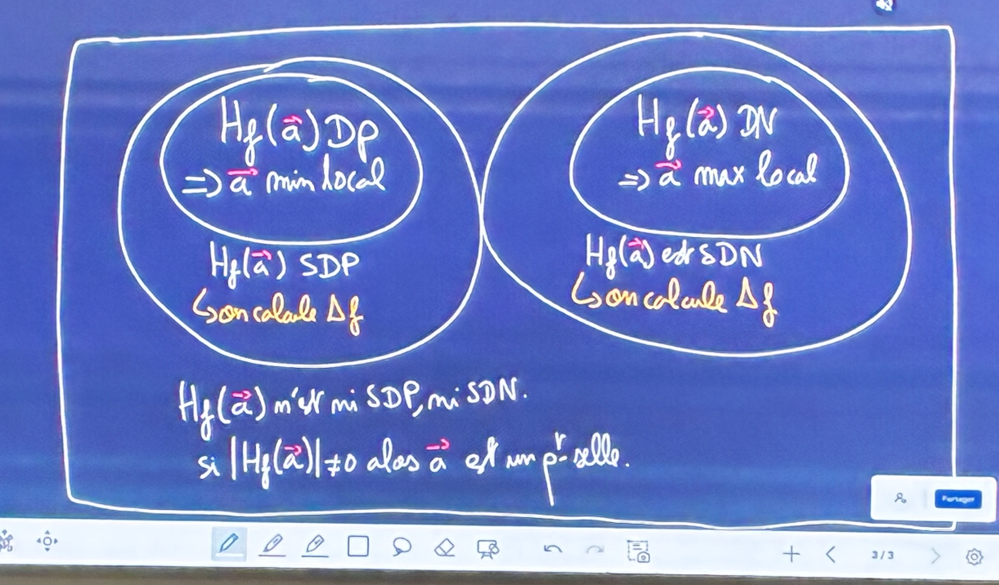

Remarque : $\Delta f = f(\vec{a}+\vec{h}) - f(\vec{a})$. On regarde le signe de $\Delta f$.

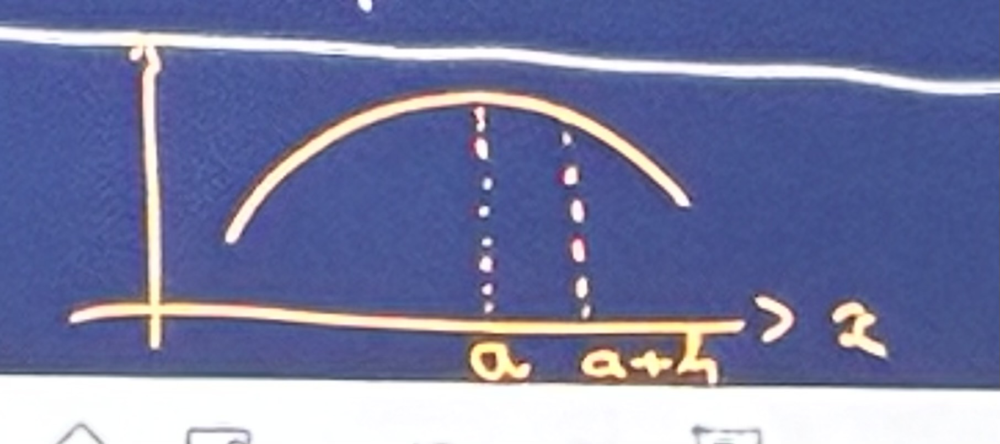

---
Exemple : 
```math
f(x,y) = 2x^3-6xy+3y^2 \\
\begin{cases}
\frac{\partial f}{\partial x} = 0 \\
\frac{\partial f}{\partial y} = 0
\end{cases}
\Leftrightarrow \text{ les points critiques sont (0,0) et (1,1)}
```
```math
H_f =
\begin{pmatrix}
12x & -6 \\
-6 & 6
\end{pmatrix} ; 
H_f(0;0) =
\begin{pmatrix}
0 & -6 \\
-6 & 6
\end{pmatrix}
```
On remarque que $0 \ge 0$ et $6 \ge 0$ et que le déterminant est inférieur à 0. Donc mi-SDN, mi-SDP or $|H_f| ≠ 0$ donc $(0;0)$ est un point selle.
```math
H_f(1;1) =
\begin{pmatrix}
12 & -6 \\
-6 & 6
\end{pmatrix}
```
On remarque que $12 \ge 0$, $6 \ge 0$ et que le déterminant est supérieur à 0, donc DP, donc $(1;1)$ est un minimum local.

---
Exemple :
```math
f(x,y) = 5x^2 + 2y^2-2xy-2x-8y
```
```math
\begin{aligned}
&\begin{cases}
\frac{\partial f}{\partial x} = 0 \\
\frac{\partial f}{\partial y} = 0
\end{cases} \\
\Leftrightarrow
&
\begin{cases}
10x -2y -2 = 0 & L_1 \\
4y-2x-8 = 0 & L_2
\end{cases} \\
\Leftrightarrow &
\begin{cases}
18x-12 = 0 & 2L_1+L_2 \\
18y-42 = 0 & L_1+5L_2
\end{cases} \\
\Leftrightarrow &
\begin{cases}
x = \frac{2}{3} \\
y = \frac{7}{3}
\end{cases}
\end{aligned}
```
```math
H_f = 
\begin{pmatrix}
10 & -2 \\
-2 & -4
\end{pmatrix}
```
On note que $H_f$ est constante. On peut donc directement vérifier les valeurs : $10 \ge 0$ et le déterminant est supérieur à 0, donc DP sur $R^2\Rightarrow \forall\vec{y}\in\R^2, H_f(\vec{y})$ est DP or le point $(\frac{2}{3};\frac{7}{3})$ est critique, donc c'est un minimum global unique.

---
Exemple du DE de 2025 :
```math
f(x,y) = x^4+xy^2-x^2
````
```math
\begin{aligned}
&\begin{cases}
\frac{\partial f}{\partial x} = 0 \\
\frac{\partial f}{\partial y} = 0
\end{cases} \\
\Leftrightarrow
&
\begin{cases}
4x^3 + y^2-2x = 0 & L_1 \\
2xy = 0 & L_2
\end{cases}
\end{aligned}
```
Si x = 0, y = 0

Si y = 0 :
```math
\begin{aligned}
&4x^3-2x=0 \\
\Leftrightarrow \space& 2x(2x^3 -1) = 0
\end{aligned}
```
Donc les couples suivants sont des points critiques :
- $(0;0)$
- $(\frac{1}{\sqrt{2}};0)$
- $(-\frac{1}{\sqrt{2}};0)$
```math
H_f =
\begin{pmatrix}
12x^2 & 2y \\
2y    & 2x
\end{pmatrix} ; H_f(\frac{1}{\sqrt{2}};0) = 
\begin{pmatrix}
4 & 0 \\
0 & \sqrt{2}
\end{pmatrix}
```
Dans ce cas, $4 > 0$ et le déterminant est positif, DP, donc $(\frac{1}{\sqrt{2}};0)$ est un minimum local
```math
H_f(-\frac{1}{\sqrt{2}};0) = 
\begin{pmatrix}
4 & 0 \\
0 & -\sqrt{2}
\end{pmatrix}
```
Dans ce cas, $4 > 0$ et le déterminant est négatif, mi-SDN mi-SDP et $|H_f| ≠ 0$, donc $(-\frac{1}{\sqrt{2}};0)$ est un point selle.
```math
H_f(0;0) = 
\begin{pmatrix}
4 & 0 \\
0 & 0
\end{pmatrix}
```
Dans ce cas, $4 > 0$, $0 \le 0$ (celui d'en bas à droite) et le déterminant est nul, donc SDN, on fait donc $\nabla f$ :
```math
\begin{aligned}
\nabla f &= f\big((0;0)+(h;k)\big) - f(0;0) \\
&= f(h;k) -f(0;0) = h^4+hk^3-h^2 \text{ On cherche le signe de ceci}
\end{aligned}

```

# Chapitre 7: Optimisation

Nous avons appris à travailler avec les fonctions de plusieurs variables. On a appris à trouver les points critiques et suceptibles d'être des extrema. Dans ce cours, on va aborder la notion de contraintes. C'est une notion fondamentale pour travailler sur des cas concrets.

Exemple : Un problème de planification, on alloue des ressources avec ≠ de planning qui se chevauchent. C'est un point d'optimisation linéaire

Autre exemple : Problème du sac à dos

$\space\Rightarrow$ Ce sont des problèmes d'optimisation sous contraintes

Quand les contraintes définissent un ensemble convexe, on a des outils pour trouver les solutions

## 1/ Les contraintes

Soit A un ouvert de $R^n$ et $f$ de classe $C^1 : A\rightarrow\R$

Le problème : On cherche les extrema de f sous p contraintes définie par des fonctions $g : A\rightarrow\R / g_i(\vec{x}) = 0, \forall\vec{x}\in A$ et $\forall i \in [i;p]$

Exemple : 
```math
\begin{aligned}
&f:\R^2\rightarrow\R \\
&(x,y) \rightarrow x^2+y^2 \\
&g:\R^2\rightarrow\R \\
&(x,y) \rightarrow x-1
\end{aligned}
\begin{aligned}
m=2 \\
p=1
\end{aligned}
\\
g=0 \Leftrightarrow x-1 = 0 \Leftrightarrow x=1 
```
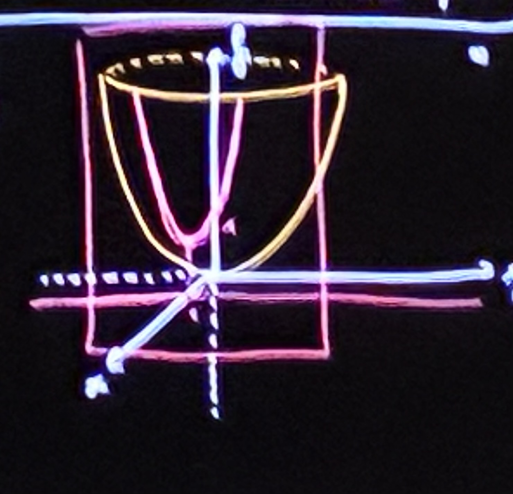

On voit bien que le minimum de $f$ est $(0;0)$. Mais que le minimum de $f$ sous la contrainte $g=0$ est ≠, et ce minimum aura au moins son $x=f$

$\space\Rightarrow$ Comment trouver ces extrema sous contrainte ?

```math
\begin{cases}
f(x,y) = x^2+y^2 \\
g(x,y) = x-1 = 0 \Rightarrow x=1
\end{cases}
\\
\begin{aligned}
\text{Donc } &f_1(y) = f(1,y) = 1+y^2 \\
&f_1'(y) = 2y \\
\text{Et }&f_1' = 0 \Leftrightarrow y=0
\end{aligned}
```
$\Rightarrow$ on continue la mise sous contrainte

Ici à basse dimension, on peut trouver la solution facilement

## 2/ Les multiplicateurs de Lagrange

On va définir une métrodologie pour éviter les substitutions. g pourrait être plus compliquée.

Définition : On appelle Lagrangien, $L = f-d_1g_1-d_2g_2-...-d_pg_p$

Les $\lambda_i$ sont les les multiplicateurs de Lagrange

Propositions : Les extrema locaux de $f$ sous les contraintes $g_1, ..., g_p$ sont à chercher parmi les points $\vec{x} \in A$.
```math
\vec{\nabla}L= \vec{0} \Leftrightarrow \frac{\partial L}{\partial x_1} = 0, \forall i\in[1;p]
```
Remarques : 
- $L$ a la "mémoire" de $f$ et des contraintes $g$.
- Cette condition $\vec{\nabla}L=\vec{0}$ est nécessaire mais pas suffisante. Donc on se sert de $\vec{\nabla}L=\vec{0}$ pour "chasser" les extrema, puis ensuite on devra vérifier s'il s'agit bien d'extrema.

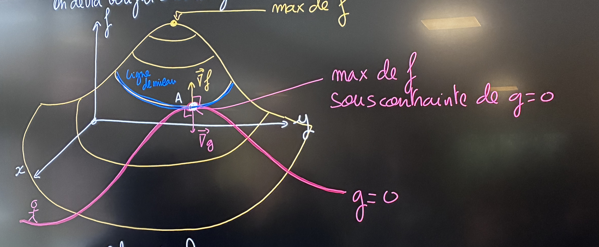

En A (maximum de la courbe rouge sous contrainte de $g=0$), $\frac{\partial f}{\partial x_1} = \lambda_1\frac{\partial g}{\partial x_1}$ car les $\nabla$ sont colinéaires.

Et donc on retrouve le fait que $\frac{\partial L}{\partial x_1}=0$ en A.

```math
\begin{cases}
f(x,y) = x^2+y^2 \\
g(x,y) = x-1
\end{cases}
\begin{aligned}
&\text{f : fonction dont on cherche les extrema} \\ 
&\text{g : contraintes}
\end{aligned}
\\
\text{Lagrangien : }L = f-\lambda g = x^2+y^2 -\lambda(x-1)
````
Attention : g=0 donc x-1=0 mais on n'annule pas x-1 dans L
```math
\vec{\nabla} L=\vec{0} \Leftrightarrow
\begin{cases}
\frac{\partial L}{\partial x} = 0 \\
\frac{\partial L}{\partial y} = 0 \\
\end{cases}
\Leftrightarrow
\begin{cases}
2x-\lambda = 0 \\
2y = 0
\end{cases}
\Leftrightarrow
\begin{cases}
2x=\lambda \\
y=0
\end{cases}
```
Contraintes : $x-1 = 0 \Leftrightarrow x=1$

Points critiques : $(1;0)$ avec $\lambda = 2$

On conclue avec 
```math
\begin{aligned}
\Delta F &= f(1+h, 0+k)-f(1,0) \\
\Delta F &= (1+h)^2+k^2 -(1^2+0^2) \\
&= 1+2h+h^2+k^2-1 \\
&= 2h+h^2+k^2
\end{aligned}
```
Contrainte : $(1+h, 0+k)\in$ contrainte

$\Rightarrow (1+h)-1=0\rightarrow h=0$

$\Rightarrow \Delta f=k^2\ge 0$ donc $(1;0)$ est un minimum local (non global car on n'a pas de DL)

---
Exemple : Trouver l'aire maximale d'un rectangle de côté $x$ et $y$ avec un périmètre donné $P$

$f=xy$ à maximiser

Contrainte : $2x+2y=P \Leftrightarrow g=2x+2y=P$
```math
L=f-\lambda g=xy-\lambda (2x+2y-P) \\
\vec{\nabla} L = \vec{0}\Leftrightarrow
\begin{cases}
\frac{\partial L}{\partial x} = 0 \\
\frac{\partial L}{\partial y} = 0
\end{cases}
\Leftrightarrow
\begin{cases}
y-2\lambda = 0 \\
x-2\lambda = 0
\end{cases}
\Leftrightarrow
x=y=2\lambda
```
Or contrainte : $2x+2y-P=0\Rightarrow x = \frac{P}{4}$

Donc le point critique est $(\frac{P}{4};\frac{P}{4})$ et $\lambda = \frac{P}{8}$

```math
\begin{aligned}
\nabla f &= f\left(\frac{P}{4}+h, \frac{P}{4}+k\right)-f\left(\frac{P}{4}, \frac{P}{4}\right) \\
&=\left(\frac{P}{4}+h\right)\left(\frac{P}{4}+k\right)-\frac{P}{4}*\frac{P}{4} \\
&= \frac{P}{4}*\frac{P}{4}+\frac{P}{4}*h+\frac{P}{4}*k+hk-\frac{P}{4}*\frac{P}{4} \\
&= \frac{P}{4}(h+k)+hk
\end{aligned}
```
(Notez que les coefficients constants doivent toujours s'annuler lors du calcul de $\nabla f$)

Contraintes : $\left(\frac{P}{4}+h;\frac{P}{4}+k\right)\in$ contraintes

```math
2\left(\frac{P}{4}+h\right)+2\left(\frac{P}{4}+k\right) = P \\
h+k = 0 \\
h=-k 
```
```math
\Rightarrow\nabla f = \frac{P}{4}(-k+k)+(-k)k = -k^2\le 0 \text{ donc } \left(\frac{P}{4};\frac{P}{4}\right)\text{ est un maximum global} \\
```
(maximum global car pas de DL)

donc pour un rectangle de périmètre fixé, son aire sera maximale quand il est carré.

## 3/ Application aux polytopes
Soit les contraintes sont des inégalités linéaires

Lorsque les contraintes sont seulement de ce type, cela forme un polytope. C'est un "diamant" convexe à n dimensions.

Si la fonction f à analyser est linéaire, les extrema se trouvent sur au moins un sommet