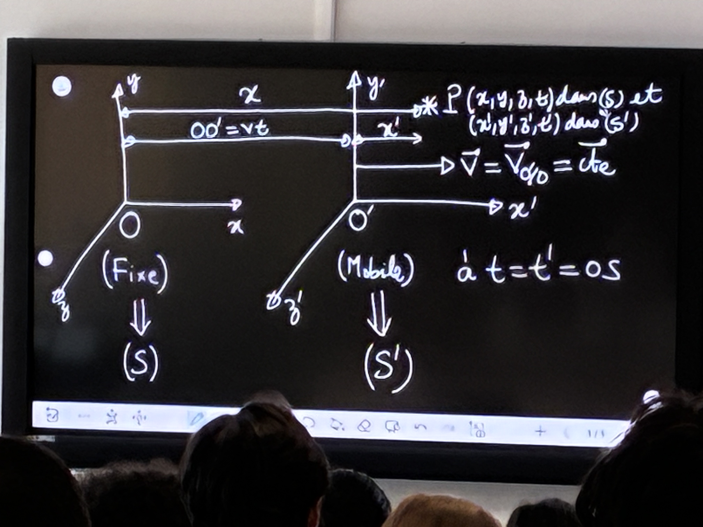
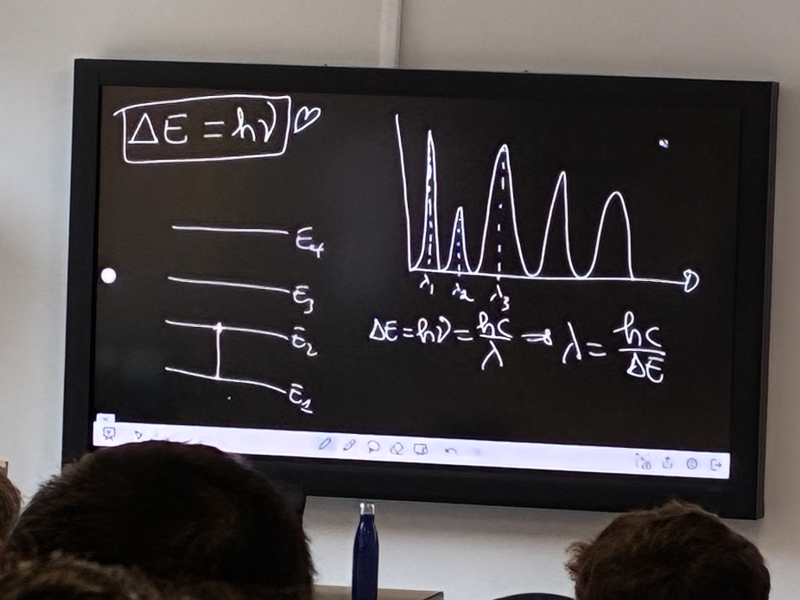
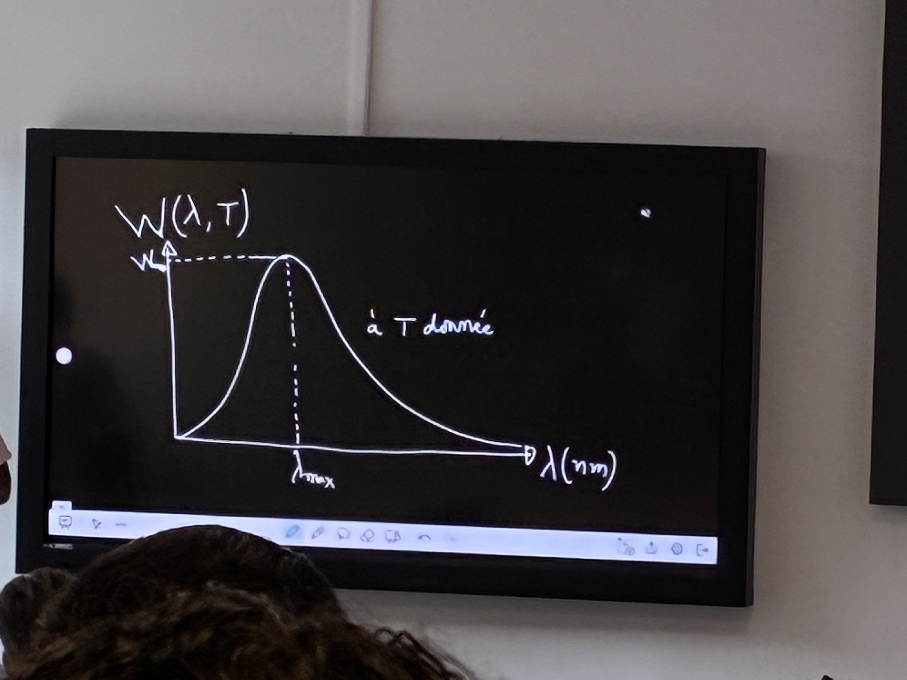

Table des matières

* [Introduction](#introduction-du-thème)
* [Rappels](#rappels)
* [Chapitre 1 : Transformation et principe de relativité Galiléenne](#chapitre-1-transformations-et-principe-de-relativité-galiléenne)
  * [1.1/ Introduction](#11-introduction)
  * [1.2/ Lois de Newton](#12-lois-de-newton)
  * [1.3/ a) Référentiel inertiel](#13-a-référentiel-inertiel)
  * [1.3/ b) Notion de référentiel](#13-b-notion-de-référentiel)
  * [1.4/ Transformation Galiléenne et ses limites](#14-transformation-galiléenne-et-ses-limites)
  * [1.5/ L'Éther](#15-léther)
* [Chapitre 2 : Théorie de la relativité restreinte](#chapitre-2-théorie-de-la-relativité-restreinte)
  * [2.1/ Les postulats d'Einstein](#21-les-postulats-deinstein)
  * [2.2/ Transformation des coordonnées de Lorentz](#22-transformation-des-coordonnées-de-lorentz)
  * [2.3/ a) La contraction des longuers : résumé](#23a-la-contraction-des-longuers--résumé)
  * [2.3/ b) La dilatation du temps : résumé](#23b-la-dilatation-du-temps--résumé)
  * [2.3/ c) Simultanéité](#23c-simultanéité)
* [Chapitre 3 : Dynamique relativiste](#chapitre-3-dynamique-relativiste)
  * [3.1/ Masse et quantité de mouvement en relativité](#31-masse-et-quantité-de-mouvement-en-relativité)
  * [3.2/ Énergie relativiste totale et énergie cinétique relativiste](#32-énergie-relativiste-totale-et-énergie-cinétique-relativiste)
* [Chapitre 4 : Onde et matière](#chapitre-4--onde-et-matière)
  * [4.1/ Introduction](#41-introduction)
    * [A/ Propriétés de la lumière (photons)](#a-propriétés-de-la-lumière-photons)
    * [B/ Spectre électromagnétique](#b-spectre-électromagnétique)
    * [C/ Quantification de l'énergie par Planck](#c-quantification-de-lénergie-par-planck)
  * [4.2/ Échec de la physique classique](#42-échec-de-la-physique-classique)
    * [A/ Spectre des atomes (spectre discrets)](#a-spectre-des-atomes-spectre-discrets)
    * [B/ Corps noirs](#b-corps-noirs)
    * [C/ Effet photoélectrique](#c-effet-photoélectrique)
    * [D/ Effet Compton](#d-effet-compton)
    * [E/ Dualité onde-particule (ou onde-corpuscule)](#e-dualité-onde-particule-ou-onde-corpuscule)
* [Chapitre 5 : Introduction à la mécanique quantique](#chapitre-5--introduction-à-la-mécanique-quantique)
  * [Slide 4](#complément-du-slide-4-onde-de-matière)
  * [Slide 5](#complément-du-slide-5-principe-dincertitude-dheisenberg-)
  * [Slide 7](#complément-du-slide-7)
  * [Slide 8-9](#complément-slide-8-9)
  * [Slide 10](#complément-slide-10)

# Introduction du thème

2 problématiques : expliquer les phénomènes microscopiques et le comportement des particules dotées d’une grande vitesse (v > 0.1c)

Relativité restreinte : le temps se dilate lorsque qu’une ou des particules sont dotées d’une grande vitesse

Mécanique quantique : décrit le monde subatomique

Cette introduction va nous permettre de bâtir sur les paradoxes expérimentaux et théoriques qui ne pouvaient être expliqués au début du XXème siècle

Transformation de Lorentz : l’espace-temps n’est plus absolu (contraction des longueurs, dilatation du temps)

# Rappels

Rappel propriétés : sinus et cosinus dans un triangle rectangle
>Soit ABC un triangle rectangle en B, et d’angle alpha en A
* cos(alpha) = AB/AC
* sin(alpha) = BC/AC
* tan(alpha) = BC/AB

Formule de la quantité de mouvement : Quantité de mouvement (vecteur) = masse * vitesse (vecteur)

Grand S: référentiel fixe avec O: origine de S

# Chapitre 1: Transformations et principe de relativité Galiléenne

## 1.1 Introduction

Voir Slide 3

## 1.2 Lois de Newton

(voir le chapitre 0)

## 1.3 a) Référentiel inertiel

**Important**: un référentiel inertiel contient maintenant une horloge

Voir Slide 6

## 1.3 b) Notion de référentiel

Voir Slide 7.

**Définition <3**: Un référentiel inertiel ou Galiléen (nommé ainsi en hommage à Galilée) est un référentiel dans lequel les lois de Newton s’appliquent (en particulier la première loi « loi d’inertie »)

**Rappel**: On représente les objets sous la forme de leur centre de masse, un point

## 1.4 Transformation Galiléenne et ses limites

Rappelons qu'un système inertiel obéit à la loi de l'inertie. Exemple : l'ensemble des axes de coordonnées attachés à la Terre peut être considéré comme un système inertiel. En effet, nous négligeons les petites accélérations résultant du mouvement de rotation et du mouvement orbital de la Terre.

Nous allons traiter tout système qui se déplace avec une vitesse uniforme constante comme un système inertiel. 

### Exemple 
Soit un événement se déroulant en un point P. P a pour coordonnées (x, y, z, t) dans S et (x', y', z' t') dans S', le référentiel mobile. S et S' étant des systèmes inertiels, en mouvement relatif uniforme.

Schéma Slide 9

Notons que v (vecteur vitesse) est selon l'axe x/x' sur le schéma. L'instant initial est à t=t'=0, lorsque les 2 systèmes inertiels coincident.

**Les coordonnées de l'événement P sont liées sous la transformation galiléenne.**

Le mouvement se faisant uniquement sur l'axe x/x', les transformations galiléennes s'écrivent :

```math
\begin{cases}
x=x'+vt \\
y=y' \\
z=z' \\
t=t' \\
\end{cases}
```

**Cette équation est la base des transformations galiléennes.**

### Remarques
1. t=t' signifie que le temps est absolu.
2. Le prime (') s'adosse au référentiel mobile (S') d'origine O'.

On peut donc réécrire l'équation relativement au référentiel :

```math
x_O = x_{O'}+v_{O/O'}t
```
```math
x_{O'} = x_O-v_{O'/O}t
```
Et en appliquant la transformation galiléenne des coordonnées à l'événement P, on écrit tout simplement
```math
x_{p/O} = x_{p/O'}+v_{O/O'}t
```
```math
x_{p/O'} = x_{p/O}+v_{O'/O}t
```
-> Transformation galiléenne des vitesses

La vitesse étant la dérivée de la position par rapport au temps, en dérivant l'équation 1 par rapport au temps on a
```math
\frac{dx}{dt}=\frac{dx'}{dt'}+v\frac{dt}{dt}
```
```math
V_x = V'_x + V
```
Avec $V = V_{O'/O} = constante$

En appliquant à l'événement P et relativement au temps, en dérivant l'équation $V_x = V'_x + V$, on a
```math
\frac{dV_x}{dt} = \frac{dV'_x}{dt'} + \frac{dV}{dt}
```
or
```math
v=v_{O'/O}=constante => \frac{dV}{dt}=0
```

On peut donc écrire

```math
\begin{cases}
a_x = a'_x \\
a_y = a'_y \\
a_z = a'_z
\end{cases}
```
ou sous forme vectorielle $\overrightarrow{a}=\overrightarrow{a'}$

-> Transformation galiléenne de l'accélération

Dans les 2 référentiels, la seconde loi de Newton s'écrit $\sum \overrightarrow{F_{ext}} = m\overrightarrow{a}$ dans S

La seconde loi de Newton est invariant sous la transformation galiléenne d'où l'énoncé du problème Newtonnien : **pour tous les systèmes inertiels qui sont en mouvement relatif uniforme, l'équation du mouvement reste invariante**

## 1.5 L'Éther
**Rappel**: les ondes mécaniques ont besoin d'un support pour se propager

L'Éther n'existe pas.

Expérience de Michelson et Morly: existance de l'éther ? càd un référentiel absolu.

Pour répondre à cette question, Michelson et Morly ont construit une expérience basée sur l'interfèromètre de Michelson qui se compose essentiellement d'une source de lumière, d'une plaque de verre moitié argentée, de 2 miroirs et d'un téléscope.

Objectif (question de cours) : **mesurer la vitesse de la lumière dans différentes directions afin de mesurer la vitesse de l'Éther par rapport à la Terre, établissant ainsi son existence.**

Conclusions d'après l'expérience de Michelson et Morly:
- nous ne sommes pas en mesure de localiser le référentiel absolu -> non existence de l'Éther.
- l'expérience de Michelson et Morly confirme que la vitesse de la lumière est invariante quelque soit le référentiel.

**Point d'attention <3**:
- La transformation galiléenne est valable pour la mécanique classique et ceci pour des objets de petite vitesse (v < 0.1c)
- Pour les transformations galiléennes, le temps est absolu: t = t'
- En général, on considère qu'un objet est relativiste (càd qu'il doit être étudié en utilisant les lois de la relativité restreinte) lorsqu'il est doté d'une grande vitesse (v>0.1c). C'est ce que nous allons développer dans les transformations de Lorentz.

# Chapitre 2: Théorie de la Relativité Restreinte
## 2.1 Les postulats d'Einstein
Slide 3+4 <3

### Postulat I: Le principe de la relativité
Énoncé : Toutes les lois de la physique sont valables dans tous les référentiels d'inertie (donc référentiel où on applique les lois de Newton)

### Postulat II: Le principe de la constance de la vitesse de la lumière
Énoncé : La vitesse de la lumière dans le vide est la même dans tous les référentiels d'inertie. Elle ne dépend pas du mouvement de la source ou de l'observateur.

Note: Les lois de la mécanique ainsi que les lois de l'électromagnétisme sont invariantes sous toutes les transformations.

## 2.2 Transformation des coordonnées de Lorentz
Considérons un système inertiel $S$ au repos et un autre système inertiel $S'$ se
déplaçant avec une vitesse $v$ le long des axes xx’.

Il y a 2 observateurs: le premier est au repos par rapport à $S$ et le second est au repos par rapport à $S’$.

Les 2 systèmes inertiels coïncident à $t=t'= 0$ et ils restent parallèles tout au long du mouvement.



**Événement**: un éclair de lumière est émis depuis l’origine commune de $S$ et $S’$. Après un certain temps, le signal lumineux atteint le point $P$ ce point est à une distance $r$ de $S$ et $r'$ de $S’$.

**Selon Newton**: La mécanique newtonienne est invariante sous les transformations galiléennes reliant deux référentiels inertiels se déplaçant à vitesse relative $v$ dans la direction $x$. Ces transformations supposent que pour atteindre le point $P$, le "temps" soit bien défini et le même ! **MAIS** la "vitesse" devrait être différente pour le deuxième observateur.

**Selon le postulat II**: La "vitesse" de la lumière $c$ est la même dans tout système inertiel. Mais le "temps" que l'événement a pris pour parcourir les distances $r$ et $r'$ est différent d'un système à l'autre car $r \neq r'$ :
```math
r = ct \text{ et } r' = ct'
```
ce qui permet de modifier les équations de transformations. Nous n'allons pas rentrer en détail dans les démonstrations (voir poly) mais pour résoudre les équations, Lorentz introduit le **facteur relativiste $\gamma$**. C'est un paramètre clé. Il s'agit du facteur par lequel le temps, les longueurs et la masse relativiste changent pour un objet tandis que cet objet est en mouvement.

```math
\gamma =\frac{1}{\sqrt{1-\beta^2}} \text{ avec } \beta=\frac{v}{c} \\
\text{Soit } \gamma=\frac{1}{\sqrt{1-\frac{v^2}{c^2}}} \text{ avec } v=v_{o'/o}
```

$v$ est la vitesse relative du mobile considéré, c est la vitesse de la lumière dans le vide ($3*10^8$), $\beta$ est la vitesse réduite définie comme le rapport de $v$ par $c$.

$\gamma$ et $\beta$ sont sans dimension, $\gamma \ge 1$

-> **Les transformations des coordonnées de Lorentz** :
>De S' vers S : 
```math
\begin{cases}
x=\gamma(x'+vt') \\
y=y' \\
z=z' \\
t=\gamma(t'+\frac{\beta}{c}x')
\end{cases}
```

Prenons un objet qui se déplace avec une vitesse qui est faible. Cela veut dire que $\frac{v}{c}$ tend vers 0, donc que $\frac{v^2}{c^2}$ tend vers 0, donc $\gamma$ tend vers 1.

Puisque seule la vitesse relative a de l'importance, un simple changement de signe de la vitesse v donne la transformation inverse :
>De S vers S':
```math
\begin{cases}
x'=\gamma(x-vt) \\
y'=y \\
z'=z \\
t'=\gamma(t-\frac{\beta}{c}x)
\end{cases}
```

-> **Les transformation des vitesses de Lorentz** :

```math
\overrightarrow{u}(u_x, u_y, u_z) \text{ dans } S \\
\overrightarrow{u'}(u_x', u_y', u_z') \text{ dans } S'
```
```math
u_x=\frac{dx}{dt}, u_y=\frac{dy}{dt}, u_z=\frac{dz}{dt}
```
```math
u_x'=\frac{dx'}{dt'}, u_y'=\frac{dy'}{dt'}, u_z'=\frac{dz'}{dt'}
```
En dérivant, on trouve :
```math
\text{(E1): }u_x=\frac{u_x'+v}{1+\frac{v*u_x'}{c^2}}
```
```math
u_y=\frac{u_y'}{\gamma(1+\frac{v*u_x'}{c^2})}
```
```math
u_z=\frac{u_z'}{\gamma(1+\frac{v*u_x'}{c^2})}
```
```math
\text{Avec } v=V_{o'/o}
```

Puisque seule la vitesse relative a de l'importance, un simple changement de signe de la vitesse v donne la transformation inverse :

```math
\text{(E2): }u_x'=\frac{u_x-v}{1-\frac{v*u_x}{c^2}}
```
```math
u_y'=\frac{u_y}{\gamma(1-\frac{v*u_x}{c^2})}
```
```math
u_z'=\frac{u_z}{\gamma(1-\frac{v*u_x}{c^2})} \\
```

Comme nous allons souvent travailler à une dimension, nous utiliserons plus souvent les équations E1 et E2.

## 2.3a) La contraction des longuers : résumé
Slide 16 <3

**Équation de la contration des longueurs** :
```math
L=\frac{L_0}{\gamma}
```
```math
L_{/s} = \frac{L_{o/s}}{\gamma}
```
```math
L_{/s'} = \frac{L_{o/s'}}{\gamma}
```
## 2.3b) La dilatation du temps : résumé
Slide 19 <3

```math
T_{/s} =\gamma T_{o/s}
```
```math
T_{/s'} =\gamma T_{o/s'}
```

### Vitesse objet relativiste 
Slide 20 <3

- si $v > 0.1c$, on applique les lois de la relativité restreinte
- si $v < 0.1c$, on applique les lois Newtoniennes, c’est-à-dire la physique classique.

## 2.3c) Simultanéité
Slide 21 <3

- En mécanique classique ($v < 0.1c$), le temps est absolu (2 événements sont simultanés soit $t=t'$) pour toutes les références.
- En relativité, rien ne se déplace à une vitesse supérieure à la vitesse de la lumière. Mais pour des grandes vitesses (v > 0.1c), si 2 événements ont lieu simultanément, cela ne signifie pas que ces 2 événements ont la même heure.


# Chapitre 3: Dynamique relativiste

## 3.1 Masse et quantité de mouvement en relativité

### Rappels mathématiques: Produit vectoriel

* Soit $\vec{u}$ et $\vec{v}$ 2 vecteurs. Le produit vectoriel $\vec{u} \wedge \vec{v}$ est un vecteur donné par la formule 
```math
||\vec{u}||*||\vec{v}||*\sin(\angle \vec{u} \vec{v})*\vec{k}
``` 
* avec $\vec{k}$ le vecteur unitaire perpendiculaire à u et v ($||\vec{k}|| = 1$)

### Application du produit vectoriel : force de Lorentz

Soit une charge $q$ de vitesse $\vec{v}$ plongeant dans un champ magnétique $\vec{B}$. L'électron est soumis à l'action de la force centripète qui modifie sa trajectoire en une courbe.


D'après ce schéma, le champ magnétique B affect la trajectoire de la particule: en effet, dans la région du champ magnétique B, l'électron est soumis à l'action de la force centripète qui modifie sa trajectoire en une courbe.

Cette force est donnée par la formule $\vec{F} = q*\vec{v}∧\vec{B}$. Le module de la force $\vec{F}$ est obtenu en utilisant l'outil mathématique du produit vectoriel donc la norme de $\vec{F}$ sera égale à:
```math
\begin{align}
||\vec{F}|| &= |q|*||\vec{v}||*||\vec{B}||*|sin\angle\vec{v}\vec{B}| \\
&= |q|*||\vec{v}||*||\vec{B}|| \text{ car l'angle est égal à }\frac{\pi}{2} \\
&= |q|*v*b
\end{align}
```

### Expérience de Bertozi: Masse relativiste non constante
D'après l'expérience de Bertozi, la force de Lorentz donne aux électrons une trajectoire circulaire avec la direction du vecteur vitesse qui change et qui permet ainsi à l'électron d'acquérir une accélération non nulle.

La composante tangentielle $a_t = $

On peut donc appliquer la seconde loi de Newton $\sum_{ext} = m\vec{a_n}$ donc $F = m\vec{a_n}$ soit en module $F = m*a_n$.
```math
\begin{align}
|q|*v*b &= m\frac{V^2}{R} \\
|q|*b &= m\frac{V}{R} \\
\text{donc } \frac{|q|BR}{mV} &= 1
\end{align}
```

Pour démontrer que la masse n'est plus constante, Bertozi trace la courbe de la dernière fraction en fonction de V. Il s'attendait à une ligne droite lorsque V varie mais il obtient la ligne suivante : 

(insérer graphe plus tard)

(en noire la courbe théorique, en rouge la courbe expérimentale)

D'après la courbe expérimentale obtenue, Bertozi a remarqué que la masse est le seul paramètre qui peut varier à grande vitesse ($v > 0.1c$). C'est ainsi qu'il définit la masse relativiste qui n'est plus constante.

### Masse et quantité de mouvement en relativité restreinte
Dans la théorie de la mécanique classique, la masse est constante c'est-à-dire absolue.

En relativité restreinte, **la masse et la quantité de mouvement ne sont pas conservées**.

**Masse relativiste**

L'expérience de Bertozi permet de montrer qu'aux grandes vitesses, la masse n'est pas constante. La masse relativiste $M$ est donc obtenue par la formule $M = \gamma m_0$ (avec $\gamma$ le facteur relativiste). $m_0$ est la masse au repos, c'est à dire sa masse classique. En effet, aux petites vitesses, $\gamma$ tend vers 1 et donc la masse $M$ tend vers $m_0$, alors que pour les grandes vitesses, la masse relativiste $M$ augmente car $\gamma > 1$.

**Quantité de mouvement relativiste**

Comme vu dans le chapitre précédent, pour des observateurs se trouvant dans des référentiels inertiels différennts, la vitesse d'une particle n'est pas la même et donc la quantité de mouvement n'est pas conservée. Par conséquent, l'expression de l'impulsion (ou quantité de mouvement relativiste) est donnée par $\vec{P}=\gamma m\vec{v}$. Cette équation définit la quantité de mouvement relativiste pour toutes les vitesses physiquement possibles. Elle tend vers la définition Newtonienne de la quantité de mouvement pour de faibles vitesses.

La masse au repos correspond à l'énergie interne de la particule et elle s'écrit $e_0 = m_0c^2$.

## 3.2 Énergie relativiste totale et énergie cinétique relativiste

L'équation $E = Mc^2$ exprime l'équivalence entre la masse relativiste et l'énergie et correspond à **l'énergie relativiste totale**. 

L'énergie relativiste totale s'écrit aussi comme $E = E_{\text{cinétique}} + E_{\text{au repos}} = T + E_0$

L'énergie cinétique relativiste $T$ n'a pas la même forme que l'énergie cinétique classique : $T = m_0c^2(\gamma-1)$. La relation reliant l'énergie relativiste totale de la particule en mouvement et la quantité de mouvement relativiste est donnée par la formule $E^2 = P^2c^2+{E_0}^2$.

### Unité

Dans le SI, l’énergie est en joule ($J$)
$u = 1.67 × 10−27kg$, u = unité de masse atomique unifiée, masse d’un proton

Pour l’énergie, on utilise l’eV :
```math
\begin{align}
1eV &= 1.6 × 10−19J \\
1 KeV &= 10^3eV \\
1 MeV &= 10^6eV \\
1 GeV &= 10^9𝑒V
\end{align}
```
L’unité de masse atomique unifiée ($1 u$) peut être exprimé par $MeV/c^2$ :
```math
\begin{align}
E &= m_0c^2 \\
&= \frac{1.67 * 10^{27} * (3 × 10^8)^2}{1.6 × 10−19} \\
&= 931.5 × 10^6eV \\
&= 931.5 MeV \\
&= 1\space uc^2 \\
\end{align}
```
```math
\text{donc } 1u = \frac{931.5 MeV}{c^2}
```

# Chapitre 4 : Onde et matière

## 4.1/ Introduction

### A/ Propriétés de la lumière (photons)

À la fin du XIXe siècle, James Maxwell ^^ définit la lumière comme étéant un faisceau d'ondes électromagnétiques. **Ce faisceau d'ondes électromagnétique est constitué de photons**.

La lumière est caractérisée par sa fréquence $\nu$ (en Hz, ou $s^{-1}$) ou sa longueur d'onde. La longueur d'onde est la distance parcourue pendant une période. (Voir slide 3)

La fréquence $\nu$ est le nombre de longueur d'ondes/d'oscillations qui traverse un point fixe par période. **La lumière se comporte donc comme une onde.** L'aspect ondulatoire a été observé dans l'expérience des franges d'interférences Young.

On peut aussi considérer la lumière comme un photon auquel on attribura une quantité de mouvement. La lumière est donc constituée de photons se déplaçant à la vitesse c et transportant une énergie $e = h\nu = \frac{hc}{\lambda}$.

### B/ Spectre électromagnétique

La gamme de fréquences et de longueur d'onde du rayonnement électromagnétique est appelée spectre électromagnétique. Actuellement, le spectre électromagnétique s'étend des rayons gamma aux ondes radios. (Voir slide 5)

**Quelques domaines du spectre électromagnétiques à connaitre par <3** : Slide 6

### C/ Quantification de l'énergie par Planck
Selon Max Planck, les atomes d'un solide oscillent avec une fréquence $\nu$ et ne peuvent avoir que certaines énergies vibratoires autorisées, notées $\Delta E = h\nu$ avec $h=6.63*10^{-34} J.s$

$h\nu$ est le quantum d'énergie, c'est la plus petite quantité d'énergie échangeable



L'équation $\Delta E = h\nu$ traduit donc la quantification de l'énergie. Cela signifie que l'énergie ne peut pas prendre n'importe quelle valeur. Le spectre des énergies n'est pas continu, il est discret.

## 4.2/ Échec de la physique classique

* [Spectre des atomes]()
* Rayonnement du corps noir
* Effet photoélectrique
* Effet Compton

Avant les années 1900, un ensemble de faits expérimentaux (voir ci-dessus) ont été prouvés par des expériences. Ces faits expérimentaux ont mis en évidence l'aspect corpusculaire de la lumière et l'avènement de la mécanique quantique

### A/ Spectre des atomes (spectre discrets)
Selon la mécanique classique, le spectre des éléments doit être continu, càd que les niveaux d'énergie peuvent prendre n'importe quelle valeur.

Mais en réalité, le spectre des atomes est discret car les niveaux d'énergie sont quantifiés.

Par exemple, pour l'atome d'hydrogène, la résolution de l'équation de Schrödinger permet de déterminer les niveaux d'énergie selon la formule $E_n=\frac{13.6}{n^2}\space eV$ avec $n\in\N^*$.

Par ailleurs, d'après l'équation de quantification d'énergie de Planck, $\Delta E = h\nu = \frac{hc}{\lambda} \Rightarrow \lambda=\frac{hc}{\Delta E}$, les niveaux d'énergies étant quantifiés, les $\Delta E$ le sont aussi, ainsi on ne peut obtenir que des valeurs de $\lambda$ spécifiques, d'où l'observation d'un spectre de raies discret (voir figure slide 9).

D'après cette figure, on constate que chaque élément a un spectre unique, ce qui constitue sa signature spectrale, son empreinte digitale.

### B/ Corps noirs

Définition : un **corps noir** est un objet idéal totalement absorbant à toute radiation électromagnétique et (donc) dont le **spectre électromagnétique ne dépend que de sa température**

La distribution spectrale d'énergie $W(\lambda, T)$ du rayonnement d'un corps noir est continue et caractérise le corps noir.



**Catastrophe de l'ultra violet** : voir slide 12

**Rayonnement du corps noir** : loi de Planck : voir slide 13 (NE PAS RETENIR LA FORMULE)

Exemple de corps noir : le Soleil, une plaque de cuisson

On observe d'après la distribution spectrale d'énergie d'un corps noir à différentes températures que la position de $\lambda_{max}$ varie avec la température (voir slide 15). Selon l'équation de la loi du déplacement de Wien (1895), $\lambda_{max}*T = 2.898*10^{-3}\space m.K$. Cette loi exprime un changement de couleur d'un objet à mesure qu'il est chauffé.

Deuxième observation : loi de Stefan : l'intensité lumineuse totale que rayonne un corps noir est la puissance totale émise à toute les longueurs d'ondes par unité de surface (I=P/S). D'après la loi de Stefan (1879), l'intensité lumineuse totale est aussi proportionelle à la quatrième puissance de sa température.

```math
I=\epsilon\sigma T^{4}
```

$\epsilon$ est l'emissivité du corps noir - pour un corps noir idéal $\epsilon = 1$ car c'est le ratio du pouvoir emissif sur celui d'un corps noir parfait. $\sigma$ est la constante de Stefan-Boltzman.

**Interprétation quantique de Planck (1900)** : voir slide 18.

Planck considère que l'énergie des oscillateurs est quantifiée, elle ne peut prendre que des valeurs discrètes ($E=nh\nu$ avec $n\in\N^*$). Les oscillateurs peuvent absorber ou émettre de l'énergie par unité discrète, multiple du quantum d'énergie fondamentale $h\nu$.

### C/ Effet photoélectrique

Définition : l'effet photoélectrique est l'ejection d'une surface metallique par l'action de la lumière ou rayonnement électromagnétique.

L'énergie du photon incident est représenté par l'équation suivante :
```math
E = h\nu
```
Travail d'extraction (l'énergie minimale pour arracher un électron du métal) :
```math
W_0 = h\nu_0
```
$\nu_0$ est la fréquence seuil (seuil photoélectrique)

$E_{Cmax} = \frac{1}{2}mV_{max}^2$  est l'énergie cinétique maximale des électrons éjectés.

L'effet photoélectrique n'a lieu que si $\nu > \nu_0$ -> éjecter un électron ne dépend pas de la puissance/énergie, mais que de la fréquence. L'émission d'électrons n'est pas conditionnée par l'intensité du rayonnement émis mais uniquement par sa fréquence.

Ainsi, si l'on augmente même fortement l'intensité du rayonnement, à une fréquence inférieure au seuil d'émission, aucun électron ne sera émis et l'effet photoélectrique n'aura pas lieu.

**L'effet photoélectrique se traduit donc par l'absorption de certains photons par le métal.** Si l'énergie du photon est supérieure à l'énergie liant un électron à un atome, cet électron peut être alors éjecté du métal, acquérant une énergie cinétique $E_{Cmax}$ et créant un courant électrique entre l'anode et la cathode de la cellule photoélectrique. Cela se traduit par l'équation d'Einstein $E = W_0 + E_{Cmax}$.

Relation entre l'énergie cinétique maximale des électrons et le potentiel d'arrêt $V_0$

En réalité, la cellule photoélectrique se compose d'un tube à vide en verre T dans lequel sont placés une plaque métallique M et une plaque collectrice de charges C (voir figure slide 20)

Le potentiel pour lequel aucun électron n'atteint la plaque C ($I = 0A$) est appelé potentiel d'arrêt $V_0$. On définit ainsi le potentiel d'arrêt comme étant la valeur en dessous de laquelle on n'observe pas d'effet photoélectrique, c'est à dire que les électrons sont arrêtés avant d'atteindre les collecteurs C.

La relation entre l'énergie cinétique maximale de l'électron et le potentiel d'arrêt $V_0$ est $E_{Cmax} = \frac{1}{2}mV_{max}^2 = e|V_0|$

Notons que $V_0$ est toujours négatif, et dépend de la fréquence de la lumière incidente $\nu$ et non de l'intensité de cette lumière.

D'après l'équation d'Einstein, $E = W_0 + E_{Cmax}$, or $E_{Cmax} = E - W_0$ donc $e|V_0| = h\nu - W_0$ et donc $|V_0| = \frac{h}{e}\nu - \frac{W_0}{e}$ (équation d'une droite).

**Attention : l'énergie cinétique maximale des électrons et le potentiel d'arrêt $v_0$ ne dépendent que de la fréquence $\nu$ et du travail d'extraction $W_0$ (qui dépend lui aussi du métal) et sont indépendantes de l'intensité lumineuse $I$**

En conclusion : tant que $\nu$ n'est pas supérieur à $\nu_0$, aucun électron n'est éjecté du métal, et l'effet photoélectrique n'a pas lieu. Pour une fréquence incidente $\nu > \nu_0$, des électrons sont émis et l'effet photoélectrique est observé.

**L'effet photoélectrique traduit l'aspect corpusculaire de la lumière c'est à dire que la lumière est constituée de petites particules appelées photons dotées d'une quantité de mouvement $p = \frac{h}{\lambda}$. Cette relation traduit la dualité onde-corpuscule. L'aspect ondulatoire étant relié à la longueur d'onde $\lambda$ et l'aspect corpusculaire à la quantité de mouvement p.**

### D/ Effet Compton

L'effet Compton (aussi appelé diffusion Compton) est un célèbre phénomène montrant que la lumière est constituée de quanta possèdant une quantité de mouvement p. Comme l'effet photoélectrique ou le rayonnement du corps noir, l'effet Compton traduit lui aussi l'aspect corpusculaire de la lumière. Il s'agit plus préciséme nt de la **collision élastique** d'un photon énergétique, par exemple un photon dans le domaine des rayons X, avec une particule de matière comme un électron pouvant être considéré comme au repos.

Un faisceau électromagnétique de longueur d’onde incident $\lambda_i$ envoyé sur une cible, interagit avec les électrons au repos et liées à la cible, subit une déviation (diffusion) avec changement de la longueur d’onde $\lambda_f$.


Un photon incident est diffusé par un seul électron de la cible, cette interaction est traitée comme une collision élastique entre le photon et l’électron.

Le schéma ci-dessus illustre l'effet Compton, càd la collision puis la diffusion d'un photon par une particule, ici un électron.

Cette collision s'accompagne d'un changement de longueur d'onde du photon après la collision. 
[...]
Qui est très similaire entre 2 particules.

Lorsque le photon après la collision a une plus grande longueur d'onde, càd qu'il a cédé de l'énergie à l'électron, on est en présence de l'effet Compton proprement dit. Lorsque la longueur d'onde diffusée est plus petite, et que le photon gagne de l'énergie au dépend de l'électron, on est en présence de l'effet Compton inverse. C'est un effet particulièrement important en astrophysique.

**Dans sa mise en équation, Compton fait l'hypothèse quantique que le photon est une particule (aspect corpusculaire) ayant une énergie $E = h\nu = \frac{hc}{\lambda}$ mais aussi une quantité de mouvement p donnée par la dualité onde-corpuscule : $p = \frac{h}{\lambda} = \frac{E}{c}$**.

On peut donc écrire les énergies et les quantités de mouvement avant et après le choc :
- Avant le choc : 
  - $E_i = h\nu_i = \frac{hc}{\lambda_i}$ 
  - $p_i = \frac{h}{\lambda_i}$
  - $E_{e^-}$
  - 
- Après le choc : $$ VOIR PHOTOS

Le choc étant élastique, on applique la conservation de l'énergie et la quantité de mouvement et on aboutit à la relation donnant le décalage de Compton $\Delta\lambda = \lambda_f - \lambda_i = \frac{h}{m_0c}(1-cos\theta)$

$\theta$ est l'angle de diffusion, càd l'angle entre la direction du photon diffusé et celle du photon incident.

On voit bien la formule donnant la longueur d'onde du photon diffusé en fonction de sa longueur d'onde $\lambda_i$ et de l'angle de diffusion : $\lambda_f = \lambda_i + \frac{h}{m_0c}(1-cos\theta)$. La constante $\lambda_c = \frac{h}{m_0c}$ est appelée longueur d'onde de Compton.

**Attention : dans l'effet Compton, on traite le photon comme une particule en collision avec l'électron initialement au repos. C'est ainsi que Compton va doter au photon, considéré comme une particule, une quantité de mouvement $p = \frac{h}{\lambda}$.**

Le photon donne de l'énergie et la quantité de mouvement à l'électron. Le photon de longueur d'onde $\lambda_f$ perd une partie de son énergie lors du choc avec l'électron. **Le photon diffusé a donc moins d'énergie mais il ne ralentit pas.**

Conclusion : l'expérience de Compton devint l'ultime observation qui convainquit la plupart des physiciens que la lumière peut se comporter comme un faisceau de particules dont l'énergie est proportionelle à sa fréquence ($E = h\nu$) ou inversement proportionelle à sa longueur d'onde. Cet effet montre que la lumière ne peut être décrit seulement comme une onde mais aussi comme un corpuscule ou particule traduisant ainsi la dualité onde-corpuscule du photon qui sera généralisée plus tard par Louis De Broglie à toute particule matérielle de masse m animé d'une vitesse v. 

### E/ Dualité onde-particule (ou onde-corpuscule)

La notion d'onde et de particule qui sont séparées en mécanique classique deviennent 2 facettes d'un même phénomène, décrit de manière mathématique par sa fonction d'onde. En particulier, l'expérience prouve que la lumière peut se comporter comme des particules (photons, mis en évidence par l’effet photo-électrique) ou comme une onde (rayonnement produisant des interférences) selon le contexte expérimental, les électrons et autres particules pouvant également se comporter de manière ondulatoire.

(voir présentation)

# Chapitre 5 : Introduction à la mécanique quantique

(Les index de slides se réfèrent au résumé)

## Complément du slide 4 onde de matière

- La probabilité de trouver la particule sur un segment de longueur N est $P\big([O,L]\big)=|\Psi(x)|^2*L$
- La probabilité de trouver la particule dans un cube de volume V est $P(V)=|\Psi(x,y,z)|^2*V$

Remarques : 
- si la fonction d'onde $\Psi \in \R$, son module au carré est égal à $\Psi^2$.
- si $\Psi\in\mathbb{C}$, son module au carré est son conjugué par lui-même ($\Psi*\Psi$)
- $\Psi^*$ est le conjugué de $\Psi$

## Complément du slide 5 (principe d'incertitude d'Heisenberg) : 

```math
\begin{aligned}
\Delta x\Delta P_x&\ge\frac{\hbar}{2} \text{ or }\hbar=\frac{h}{2π} \\
\Delta x\Delta P_x&\ge\frac{h}{4π} \text{ or }P_x=mV_x \\
\Delta x\Delta(mV_x)&\ge\frac{h}{4π}\text{ or } m=cte \\
m\Delta x\Delta(V_x)&\ge\frac{h}{4π}\\
\Delta x\Delta(V_x)&\ge\frac{h}{4πm} \\
\Big(\Delta(V_x)_{lim}\Big)&\ge\frac{h}{4πm\Delta x} \\
\end{aligned}
```

$\Delta x$ est l'incertude sur la position, $\Delta V_x$ est l'incertitude absolue sur la vitesse. Connaissant par exemple $\Delta x$, on peut en déduire l'incertitude limite sur la vitesse.

## Complément du slide 7

Pour une particule confinée dans un puits de potentiel infinément profond de largeur $L$, la résolution de l'équation de Schrödinger donne

```math
\Psi_n(x) = A\sin\left(\frac{nπx}{L}\right)
```

La condition de normalisation s'écrit donc :

```math
\int^L_0 |A|^2\sin^2\left(\frac{n\pi x}{L}\right)\space dx = 1
```

avec $n\in \N^*$ représentant les indices des états stationnaires

## Complément slide 8-9

Opérateur position à une dimension : $\hat{x}$. Son effet sur une fonction d'onde de matière conduit à une multiplication de la position par la fonction d'onde de matière : $\hat{x} = x\Psi$.

Opérateur impulsion/qtité de mouvement à une dimension : $\hat{P_x} = -i\hbar\frac{d}{dx}$ (dérive une fois)

On rappelle que $\hbar = \frac{h}{2π}$ et $i$ le nombre complexe tel que $i^2 = -1$.

Opérateur énergie cinétique à une dimension : $\hat{E_c}=-\frac{\hbar^2}{2m}\frac{d^2}{dx^2}$ (dérive 2 fois)

## Complément slide 10

La valeur moyenne des mesures associées à un opérateur $\hat{a}$ quelconque a pour expression $<\hat{a}> = <\Psi|\hat{a}|\Psi> = \int_x\Psi^*(x)\hat{a}\Psi(x)\space dx$